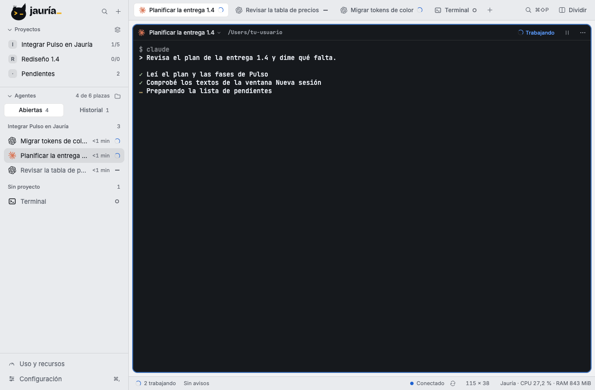
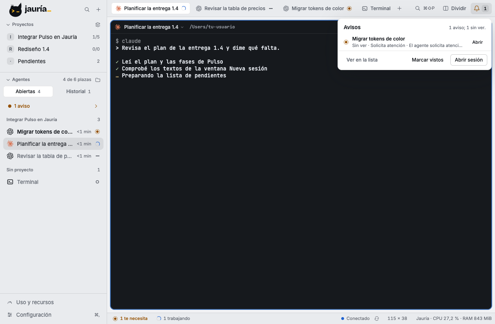
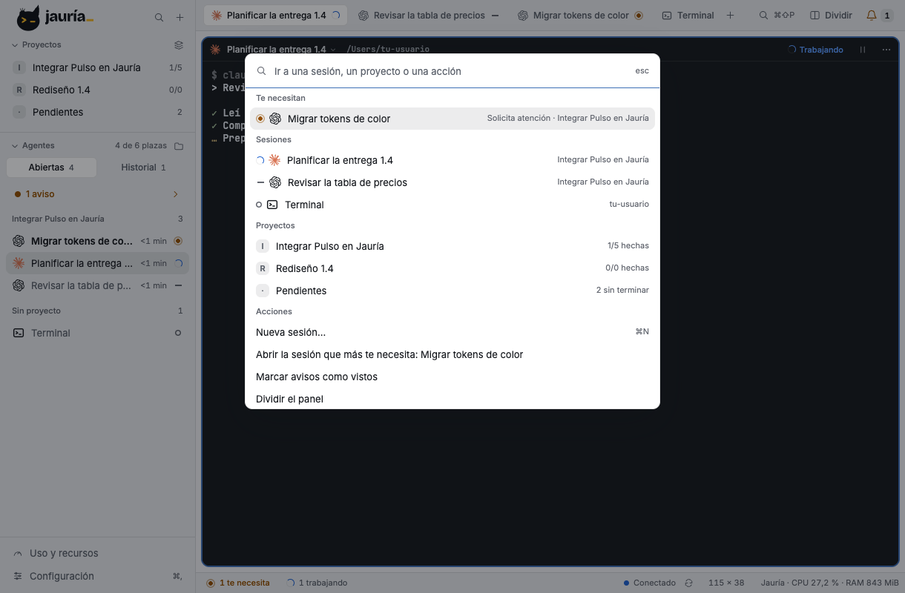

# Jauria — Claude Code and Codex session manager for macOS

[Español](README.md) · English

Jauria is a macOS desktop app for managing **Claude Code, OpenAI Codex and zsh terminal sessions**. Organize sessions by working directory, inspect local history, and view two sessions side by side. Jauria is built with Tauri and Rust and is independent of OpenAI and Anthropic.

> **1.4.0 prepared, not yet published:** this branch (`feat/redesign-1.4`) has `VERSION` 1.4.0, but there is no `v1.4.0` tag, DMG or GitHub release yet. The published release is still 1.3.3, whose app cannot save **Configuración** against its own runner; 1.4.0 fixes that (see the [changelog](CHANGELOG.md)).

**Version 1.4.0** — read the [1.4.0 notes](docs/RELEASE_1.4.0.md) (Spanish). The latest published [GitHub release](https://github.com/StevenSantacruz56/jauria-sessions/releases/tag/v1.3.3) is 1.3.3, with source and a verified Apple Silicon DMG. The app is unsigned for Developer ID distribution and is not notarized; read the [installation limits](docs/INSTALLATION.md) before downloading. Original code is licensed under [GPL-3.0-only](LICENSE). The app declares macOS 11.0 as its minimum, with testing limited to the current development Mac. Intel, Linux and Windows are not supported by this release.

## What you can do

- Start a session in any directory, including your home directory, without creating a project.
- Run Claude Code, Codex or a normal zsh terminal. Configure a combined limit of 1–8 concurrent sessions; the default is 2. Two visible panes do not limit the number of open sessions.
- Rename active or historical sessions through the pane actions menu.
- Edit the same repository in parallel from separate Git worktrees. Jauria enforces one managed writer per worktree. Shell and provider settings determine filesystem and command permissions.
- Inspect session state, optional attention notifications, provider usage when available, and observed CPU/RAM consumption.

Since 1.4, Jauria no longer includes **Repositorios** or Git tasks (repository registration, a worktree per task, review, verification and handoff). Data from that feature in a profile created by an earlier version is kept on disk and ignored; Jauria never deletes worktrees or branches, and you can open an ordinary session in any of those folders.

**Pulso** gives each project a tab with four fixed columns: **Por hacer** (to do), **En curso** (in progress), **En espera** (waiting) and **Hecho** (done). The fixed **Pendientes** tab holds standalone cards, including completed ones.

1. In Pulso, choose the **+** (Nuevo proyecto) next to the board tabs in the top bar, enter its name and select **Crear proyecto**. When a current session exists, the checkbox to use it as the main session starts checked. Creating the project opens its board tab.
2. Add phases inline with **Añadir fase** in the first three columns (**Añadir pendiente** for standalone cards).
3. Drag a card by its grip to another column, or open its **…** menu (Mover a Por hacer, En curso, En espera or Hecho), which also works from the keyboard. Moves change status while preserving phase order. Reordering within a column, custom columns and moves across projects are deferred.
4. A card's title opens the right drawer; it does not start a PTY. Edit title, notes and status, read the latest checkpoint and next step, or expand **Guardar avance** to append an immutable checkpoint. History loads 10 at a time.
5. **Plan y sesiones** in the project board toolbar opens the optional plan, main session, links and grants, keeping those controls off the board.
6. Since 1.4, with a 1.4 runner, each card's footer shows its linked session (live status, provider, name) and its checkpoint count; selecting it opens that session. The sidebar and the board refresh within about a second when an agent edits Pulso over MCP, without polling.

Permissions, saved policies, revocation and macOS notices live in **Configuración**. Pulso remembers the last board per profile and offers a direct action to continue the project or focus its existing Claude continuation.

Return directly to a live session, inspect local history, or edit and copy phase context before opening a new blank session. Context is never sent automatically to the PTY. Exact-ID Claude resume remains an attempt for identities reserved by Jauria, subject to provider history and existing locks. Codex keeps its terminal, history and copied context; native Codex resume is unavailable. The local CLI retains explicit project-scoped manual grants and revocable policies; website import and cloud sync remain deferred.

### Pulso, Claude Code, and Codex

Pulso is Jauria's local board for projects, phases, and progress checkpoints. Since 1.3.3, new Claude Code and Codex sessions started from Jauria automatically receive the `jauria-pulso` MCP server and access to all local Pulso projects, including project creation. **Configuración → Pulso y agentes → Acceso automático a Pulso** starts enabled and can be turned off. Each session has a private, revocable credential. Native file, command, and network permissions remain with each provider.

An already running conversation will not load a newly registered MCP server. For that conversation, open **Configuración → Pulso y agentes → Dar o quitar acceso a una sesión ya abierta** and use **Copiar instrucciones para el agente**. The copied local command includes the private grant-file path, not its token; share it only in the selected conversation. Remembered manual policies can narrow access by project, provider, and directory. See [Pulso's privacy and permission limits](docs/PULSO.md#privacidad-permisos-y-límites).

Explicit **OSC 7501** reports appear in the sidebar, the session tab and the pane heading. They never update phases or prove that work was validated. Jauria installs no hooks and changes no agent configuration. A running session with no report is labeled as progress not reported. Replay creates no status or alerts. Since 1.4, with a 1.4 runner, the runner reads those signals and keeps the state, the turn duration and what you have already seen, so they survive closing the window and reconnecting. With a 1.3.x runner, reconnecting resets this ephemeral state.

**Agentes → Por estado** groups sessions in the sidebar by action needed, notices, finished turns, working and idle (the Actividad sections). It shows how long an agent has reported working. A finished turn stays pending through a later `idle` report (with a 1.4 runner, also through a new turn) until you open the session; `blocked` stays visible while reported. The bell in the top bar lists pending alerts and opens the relevant session, and the status bar counts sessions that need you, finished or are working; marking an alert seen never approves a permission or resolves an error. With a 1.4 runner, pending alerts show in the bell, status bar and Dock as soon as the window opens, but macOS does not notify about them after the fact. Optional macOS notices use generic wording without session names or paths. See the [status rules and limits](docs/SESSION_ALERTS.md#actividad-y-avisos-desde-131) (Spanish).

The board uses bounded snapshots with counts and pages per column, with no hidden Pulso polling. Existing storage budgets and consistent SQLite backup guidance still apply. Read the [Pulso guide](docs/PULSO.md), [Herdr review and decisions](docs/HERDR_REVIEW.md), [1.3.1 activity implementation](docs/RELEASE_1.3.1.md), and [1.4.0 release notes](docs/RELEASE_1.4.0.md) (Spanish).

The published **1.3.3** DMG is verified with a SHA-256 checksum and JSON receipt ([validation and limits](docs/RELEASE_1.3.3.md)). The 1.4.0 test results and known limits are in [its notes](docs/RELEASE_1.4.0.md#verificación-de-la-entrega); see also [the activity implementation](docs/RELEASE_1.3.1.md) and [earlier Pulso validation](docs/PULSO_VALIDATION_1.3.0.md).

See the [screenshots and full usage guide](README.md#capturas). All screenshots below show the 1.4.0 interface with synthetic data: no real profile, session, path or task.

<picture>
  <source media="(prefers-color-scheme: dark)" srcset="docs/screenshots/terminal-1.4.0-oscuro.png">
  
</picture>

<picture>
  <source media="(prefers-color-scheme: dark)" srcset="docs/screenshots/actividad-1.4.0-aviso-oscuro.png">
  
</picture>

<picture>
  <source media="(prefers-color-scheme: dark)" srcset="docs/screenshots/pulso-1.4.0-oscuro.png">
  
</picture>

<picture>
  <source media="(prefers-color-scheme: dark)" srcset="docs/screenshots/paleta-1.4.0-oscuro.png">
  
</picture>


## Install and start

The [v1.3.3 GitHub release](https://github.com/StevenSantacruz56/jauria-sessions/releases/tag/v1.3.3) includes source, `Jauria_1.3.3_aarch64_unsigned.dmg`, `SHA256SUMS`, and a JSON receipt. Verify the checksum before use. The app lacks a Developer ID signature and notarization, so macOS may block it. Do not disable Gatekeeper or remove quarantine; if blocked, wait for a signed and notarized build. See the [installation and update guide](docs/INSTALLATION.md).

Jauria itself does not require Rust or Node to run from an app bundle. Provider CLIs must be installed and authenticated separately. This release expects Codex at `/opt/homebrew/bin/codex` and Claude Code at `~/.local/bin/claude`; Terminal uses `/bin/zsh -il`.

1. Open **Nueva sesión** (`⌘N`).
2. Choose Codex, Claude Code or Terminal and a working directory.
3. Optionally name the session, then select **Iniciar sesión**.
4. Open **Configuración…** (`⌘,`) to change the appearance, the terminal font size (11–18 px), the sidebar grouping and layout, the concurrency limit, Pulso access and macOS notices, or to see the app and runner versions, check the CLIs, preview a diagnostic and restart the runner. Every change applies and is saved at once; there is no Guardar button.
5. Use **Dividir** to display two sessions side by side.
6. Press `⌘⇧P` (or the search button in the top bar) for the **command palette**: sessions that need you, open sessions, Pulso boards and actions, filtered as you type. Unavailable actions are listed with the reason; **Terminar** and **Cambiar nombre** open their usual confirmation or form, and the palette never types into a terminal. `⌘K` still filters the agent list. The Información panel and `⌘I` were retired in 1.4.0: its useful parts moved to Configuración and to the pane's «…» menu (folder, identifier, history clean-up).
7. The sidebar has two independently scrolling areas, **Proyectos** and **Agentes**: drag the line between them or the right edge (220–420 px), or use the arrow keys, Home/End and Enter on the focused separator; click a heading to fold it. The layout is remembered per profile.

The current interface is in Spanish. Closing its window leaves sessions running in the local runner; **Terminar** stops the selected process while preserving files and saved history; once the runner confirms it, the pane moves to the next open session (or the welcome view) and the ended one stays in Historial, read only. A session that ends on its own stays in its pane with a **Cerrar** button. **Interrumpir** sends Ctrl-C without guaranteeing that the process exits.

## Frequently asked questions

**Can I use Claude Code and Codex in parallel on macOS?** Yes, within Jauria's combined session limit and each provider's own account limits. Use separate Git worktrees for parallel editing of the same repository.

**Does local history retention limit provider usage?** The local storage budget controls saved terminal output. Reaching it does not stop a running terminal, but some output may be unavailable after reconnecting. It does not change a provider's account quota.

**Does installing an update replace a running session?** Existing runners retain their executable. Finish active work before using Configuración → Acerca de y diagnóstico → Reiniciar runner…; new launch settings apply to newly started sessions.

**Can I reuse or cite Jauria?** The original source is GPL-3.0-only. Preserve third-party notices and comply with the corresponding-source requirements when redistributing binaries. Brand assets have separate conditions in [NOTICE](NOTICE.md). [CITATION.cff](CITATION.cff) provides software citation metadata without claiming endorsement or search ranking.

## Build from source

On macOS Apple Silicon, install Xcode Command Line Tools, Rust stable, Node 24+, npm, Git and Python 3.9+:

```sh
git clone https://github.com/StevenSantacruz56/jauria-sessions.git
cd jauria-sessions
python3 scripts/build-macos.py
python3 scripts/launch-macos.py --data "$HOME/Library/Application Support/Jauria-local"
```

The build also runs the browser suites, which need Google Chrome and Playwright WebKit (`npx playwright install webkit` in `experiments/tauri-vertical/desktop`); `--skip-browser-tests` skips them and says so. The default desktop build is optimized release mode and unsigned. Use `--debug` on both scripts for development bundles. Packaging and developer details are in [DEVELOPMENT.md](docs/DEVELOPMENT.md).

## Project status and security

Read the [changelog](CHANGELOG.md), [1.4.0 notes](docs/RELEASE_1.4.0.md), [1.3.3 notes](docs/RELEASE_1.3.3.md), [security policy](SECURITY.md), and [publication readiness review](docs/PUBLICATION_READINESS.md). Local tests and a scoped exposure review do not certify that the software is free of vulnerabilities. Discovery and citations in search-assisted tools are not guaranteed; see [DISCOVERABILITY.md](docs/DISCOVERABILITY.md).
