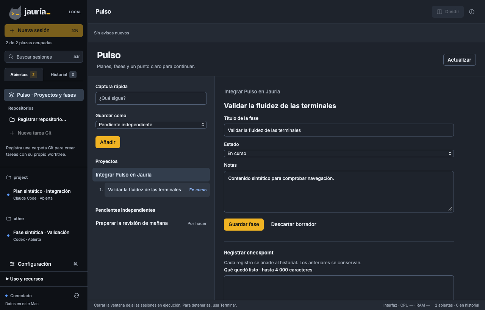

# Jauria — Claude Code and Codex session manager for macOS

[Español](README.md) · English

Jauria is a macOS desktop app for managing **Claude Code, OpenAI Codex and zsh terminal sessions**. Organize sessions by working directory, inspect local history, and view two sessions side by side. Jauria is built with Tauri and Rust and is independent of OpenAI and Anthropic.

**Current version: 1.1.0.** Original code is licensed under [GPL-3.0-only](LICENSE). The supported distribution targets Apple Silicon; the app declares macOS 11.0 as its minimum, with testing limited to the current development Mac. Intel, Linux and Windows are not supported by this release.

## What you can do

- Start a session in any directory, including your home directory, without creating a project.
- Run Claude Code, Codex or a normal zsh terminal. Configure a combined limit of 1–8 concurrent sessions; the default is 2. Two visible panes do not limit the number of open sessions.
- Rename active or historical sessions through the pane actions menu.
- Register Git repositories and create a separate worktree for each parallel editing task. Jauria enforces one managed writer per worktree. Shell and provider settings determine filesystem and command permissions.
- Inspect session state, optional attention notifications, provider usage when available, and observed CPU/RAM consumption.

**Pulso** brings work or business plans, ordered phases and standalone pending items into the same app, separate from Git repositories. When creating a project, a checked box links the current session as its main session when available; you can uncheck it or change the main session later. Phases have optional session links and immutable checkpoints recording progress and the next action. The detail shows the latest 10 checkpoints; **Ver puntos anteriores** loads 10 more at a time.

Separate buttons focus a live session or view local history. You can edit and copy phase context, then open a new blank session; context is never sent automatically. Managed Claude conversations with a reserved identity support an exact-ID resume attempt, without guaranteeing provider history. Pulso can focus an existing live continuation and links a resumed session to the selected project/phase while retaining origin metadata. Codex remains in its terminal, with local history and copied context; native Codex identity capture/resume is unavailable.

Authorized agents can register and update work through a scoped local CLI. Access requires an explicit grant; the remember box starts unchecked, and saved policies can be managed and revoked. MCP is deferred. There is no automatic import from the earlier Pulso website or cloud sync.

SQL queries return bounded pages. Pulso has a logical budget of 64 MiB/100,000 rows, plus 1 MiB/2,000 rows of headroom only for permission principals and policies, and a 128 MiB physical cap on its own database. Reads remain available at budget. There is no automatic deletion or export UI; the guide describes consistent SQLite backup, not raw copying of an open database.

Installed-app activation and real-profile testing have not been performed for 1.1.0. Final test counts and metrics await the main task's validation closeout.

Read the [Pulso guide](docs/PULSO.md) (Spanish) and [1.1.0 release notes](docs/RELEASE_1.1.0.md).

See the [screenshots and full usage guide](README.md#capturas).



Pulso: a project holds a complete plan, with phases and continuity points. Synthetic interface screenshot; no real session data.

## Install and start

GitHub releases currently contain **source code and documentation**, with **no DMG attachments**. The unsigned installer remains local; access to repository content follows its GitHub visibility and permissions. A public, signed and notarized installer has not been distributed. See the [installation and update guide](docs/INSTALLATION.md).

Jauria itself does not require Rust or Node to run from an app bundle. Provider CLIs must be installed and authenticated separately. This release expects Codex at `/opt/homebrew/bin/codex` and Claude Code at `~/.local/bin/claude`; Terminal uses `/bin/zsh -il`.

1. Open **Nueva sesión** (`⌘N`).
2. Choose Codex, Claude Code or Terminal and a working directory.
3. Optionally name the session, then select **Iniciar sesión**.
4. Open **Configuración…** (`⌘,`) to change appearance or the concurrency limit.
5. Use **Dividir** to display two sessions side by side.

The current interface is in Spanish. Closing its window leaves sessions running in the local runner; **Terminar** stops the selected process while preserving files and saved history. **Interrumpir** sends Ctrl-C without guaranteeing that the process exits.

## Frequently asked questions

**Can I use Claude Code and Codex in parallel on macOS?** Yes, within Jauria's combined session limit and each provider's own account limits. Use separate Git worktrees for parallel editing of the same repository.

**Does local history retention limit provider usage?** The local storage budget controls saved terminal output. Reaching it does not stop a running terminal, but some output may be unavailable after reconnecting. It does not change a provider's account quota.

**Does installing an update replace a running session?** Existing runners retain their executable. Finish active work before using Información → Diagnóstico → Reiniciar runner…; new launch settings apply to newly started sessions.

**Can I reuse or cite Jauria?** The original source is GPL-3.0-only. Preserve third-party notices and comply with the corresponding-source requirements when redistributing binaries. Brand assets have separate conditions in [NOTICE](NOTICE.md). [CITATION.cff](CITATION.cff) provides software citation metadata without claiming endorsement or search ranking.

## Build from source

On macOS Apple Silicon, install Xcode Command Line Tools, Rust stable, Node 24+, npm, Git and Python 3.9+:

```sh
git clone https://github.com/StevenSantacruz56/jauria-sessions.git
cd jauria-sessions
python3 scripts/build-macos.py
python3 scripts/launch-macos.py --data "$HOME/Library/Application Support/Jauria-local"
```

The default desktop build is optimized release mode and unsigned. Use `--debug` on both scripts for development bundles. Packaging and developer details are in [DEVELOPMENT.md](docs/DEVELOPMENT.md).

## Project status and security

Read the [changelog](CHANGELOG.md), [1.1.0 notes](docs/RELEASE_1.1.0.md), [security policy](SECURITY.md), and [publication readiness review](docs/PUBLICATION_READINESS.md). Local tests and a scoped exposure review do not certify that the software is free of vulnerabilities. Discovery and citations in search-assisted tools are not guaranteed; see [DISCOVERABILITY.md](docs/DISCOVERABILITY.md).
