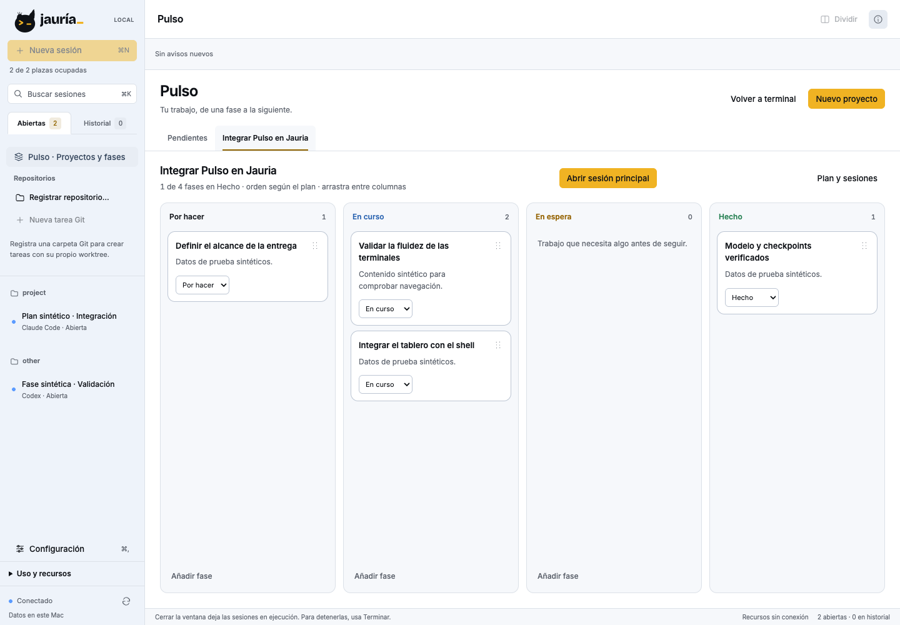

# Jauria — Claude Code and Codex session manager for macOS

[Español](README.md) · English

Jauria is a macOS desktop app for managing **Claude Code, OpenAI Codex and zsh terminal sessions**. Organize sessions by working directory, inspect local history, and view two sessions side by side. Jauria is built with Tauri and Rust and is independent of OpenAI and Anthropic.

**Current source version: 1.3.1.** GitHub releases currently stop at 1.0.1; newer app bundles and installers are prepared locally. Original code is licensed under [GPL-3.0-only](LICENSE). The supported distribution targets Apple Silicon; the app declares macOS 11.0 as its minimum, with testing limited to the current development Mac. Intel, Linux and Windows are not supported by this release.

## What you can do

- Start a session in any directory, including your home directory, without creating a project.
- Run Claude Code, Codex or a normal zsh terminal. Configure a combined limit of 1–8 concurrent sessions; the default is 2. Two visible panes do not limit the number of open sessions.
- Rename active or historical sessions through the pane actions menu.
- Register Git repositories and create a separate worktree for each parallel editing task. Jauria enforces one managed writer per worktree. Shell and provider settings determine filesystem and command permissions.
- Inspect session state, optional attention notifications, provider usage when available, and observed CPU/RAM consumption.

**Pulso 1.3.0** gives each project a tab with four fixed columns: **Por hacer** (to do), **En curso** (in progress), **En espera** (waiting) and **Hecho** (done). The fixed **Pendientes** tab holds standalone cards, including completed ones. Git repositories remain separate.

1. Choose **Nuevo proyecto**, enter its name and select **Crear proyecto**. When a current session exists, the checkbox to use it as the main session starts checked. Creating the project opens its board tab.
2. Add phases inline with **Añadir fase** in the first three columns (**Añadir pendiente** for standalone cards).
3. Drag a card by its grip to another column, or use the keyboard-accessible **Mover** select. Moves change status while preserving phase order. Reordering within a column, custom columns and moves across projects are deferred.
4. A card's **Abrir** action opens the right drawer; it does not start a PTY. Edit title, notes and status, read the latest checkpoint and next step, or expand **Guardar avance** to append an immutable checkpoint. History loads 10 at a time.
5. **Plan y sesiones** in the project board toolbar opens the optional plan, main session, links and grants, keeping those controls off the board.

Permissions, saved policies, revocation and macOS notices live in **Configuración**. Pulso remembers the last board per profile and offers a direct action to continue the project or focus its existing Claude continuation.

Return directly to a live session, inspect local history, or edit and copy phase context before opening a new blank session. Context is never sent automatically to the PTY. Exact-ID Claude resume remains an attempt for identities reserved by Jauria, subject to provider history and existing locks. Codex keeps its terminal, history and copied context; native Codex resume is unavailable. The local CLI retains explicit project-scoped grants and revocable policies. The 1.3.0 runner includes an optional local MCP server; website import and cloud sync remain deferred.

### Pulso and Claude Code

Pulso is Jauria's local board for projects, phases, and progress checkpoints. Its optional `jauria-pulso` MCP server exposes eight tools, but Jauria does not automatically add the server to Claude Code or grant it access. Follow the [Claude Code setup](docs/PULSO.md#mcp-local-opcional-para-nuevas-sesiones), then start a new Claude Code session from Jauria and check `/mcp`. In **Configuración → Permisos de agentes**, select that session and either one project or the explicit **Crear proyectos propios** scope. Remembering access is off by default.

An already running Claude conversation will not load a newly registered MCP server. For that conversation, grant access and use **Copiar instrucciones para el agente** instead. The copied local command includes the private grant-file path, not its token; share it only in the selected conversation. This Claude Code server is separate from Claude Desktop connectors. See [Pulso's privacy and permission limits](docs/PULSO.md#privacidad-permisos-y-límites).

Explicit **OSC 7501** reports appear in the live view and **Actividad**. They never update phases or prove that work was validated. Jauria installs no hooks and changes no agent configuration. A running session with no report is labeled as progress not reported. Replay creates no status or alerts; reconnecting resets this ephemeral state.

**Actividad** groups sessions by action needed, notices, finished turns, working and idle. It shows how long an agent has reported working. A finished turn stays pending through a later `idle` report until you open the session; `blocked` stays visible while reported. The header alert opens the relevant session, while marking an alert seen never approves a permission or resolves an error. Optional macOS notices use generic wording without session names or paths. See the [status rules and limits](docs/SESSION_ALERTS.md#actividad-y-avisos-desde-131) (Spanish).

The board uses bounded snapshots with counts and pages per column, with no hidden Pulso polling. Existing storage budgets and consistent SQLite backup guidance still apply. Read the [Pulso guide](docs/PULSO.md), [Herdr review and decisions](docs/HERDR_REVIEW.md), and [1.3.1 release notes](docs/RELEASE_1.3.1.md) (Spanish).

The local **1.3.1** release is built and its DMG verified. See [this version's validation and limits](docs/RELEASE_1.3.1.md) and [earlier Pulso validation](docs/PULSO_VALIDATION_1.3.0.md). The example uses a separate profile; existing sessions were preserved and the installer was not published.

See the [screenshots and full usage guide](README.md#capturas). The current board is shown below.



Example board in Jauria 1.3.0. Synthetic screenshot: no real session or task data.

## Install and start

GitHub releases currently contain **source code and documentation through 1.0.1**, with **no 1.3.1 DMG attachment**. The unsigned 1.3.1 installer remains local; access to repository content follows its GitHub visibility and permissions. A public, signed and notarized installer has not been distributed. See the [installation and update guide](docs/INSTALLATION.md).

Jauria itself does not require Rust or Node to run from an app bundle. Provider CLIs must be installed and authenticated separately. This release expects Codex at `/opt/homebrew/bin/codex` and Claude Code at `~/.local/bin/claude`; Terminal uses `/bin/zsh -il`.

1. Open **Nueva sesión** (`⌘N`).
2. Choose Codex, Claude Code or Terminal and a working directory.
3. Optionally name the session, then select **Iniciar sesión**.
4. Open **Configuración…** (`⌘,`) to change appearance or the concurrency limit.
5. Use **Dividir** to display two sessions side by side.

The current interface is in Spanish. Closing its window leaves sessions running in the local runner; **Terminar** stops the selected process while preserving files and saved history. **Interrumpir** sends Ctrl-C without guaranteeing that the process exits.

## Frequently asked questions

**Can I use Claude Code and Codex in parallel on macOS?** Yes, within Jauria's combined session limit and each provider's own account limits. Use separate Git worktrees for parallel editing of the same repository.

**Does local history retention limit provider usage?** The local storage budget controls saved terminal output. Reaching it does not stop a running terminal, but some output may be unavailable after reconnecting. It does not change a provider's account quota.

**Does installing an update replace a running session?** Existing runners retain their executable. Finish active work before using Información → Diagnóstico → Reiniciar runner…; new launch settings apply to newly started sessions.

**Can I reuse or cite Jauria?** The original source is GPL-3.0-only. Preserve third-party notices and comply with the corresponding-source requirements when redistributing binaries. Brand assets have separate conditions in [NOTICE](NOTICE.md). [CITATION.cff](CITATION.cff) provides software citation metadata without claiming endorsement or search ranking.

## Build from source

On macOS Apple Silicon, install Xcode Command Line Tools, Rust stable, Node 24+, npm, Git and Python 3.9+:

```sh
git clone https://github.com/StevenSantacruz56/jauria-sessions.git
cd jauria-sessions
python3 scripts/build-macos.py
python3 scripts/launch-macos.py --data "$HOME/Library/Application Support/Jauria-local"
```

The default desktop build is optimized release mode and unsigned. Use `--debug` on both scripts for development bundles. Packaging and developer details are in [DEVELOPMENT.md](docs/DEVELOPMENT.md).

## Project status and security

Read the [changelog](CHANGELOG.md), [1.3.1 notes](docs/RELEASE_1.3.1.md), [security policy](SECURITY.md), and [publication readiness review](docs/PUBLICATION_READINESS.md). Local tests and a scoped exposure review do not certify that the software is free of vulnerabilities. Discovery and citations in search-assisted tools are not guaranteed; see [DISCOVERABILITY.md](docs/DISCOVERABILITY.md).
