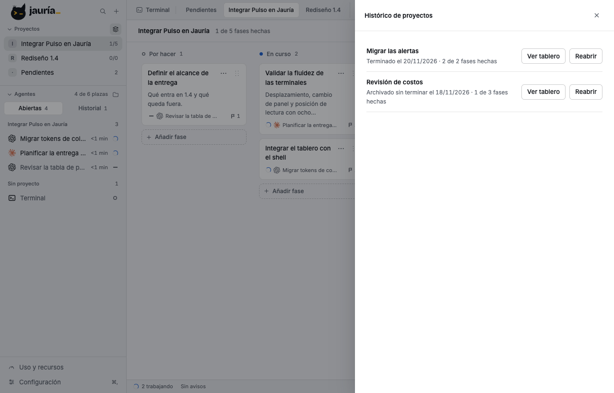
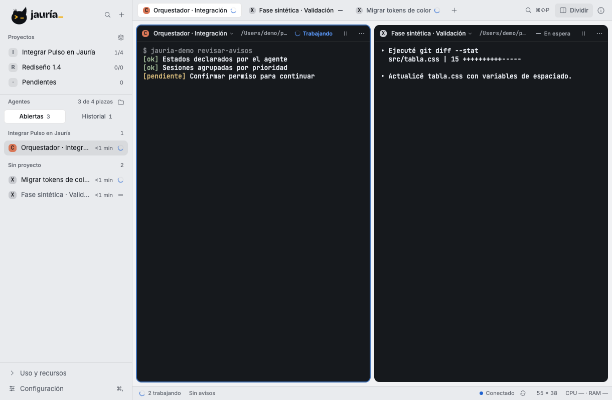
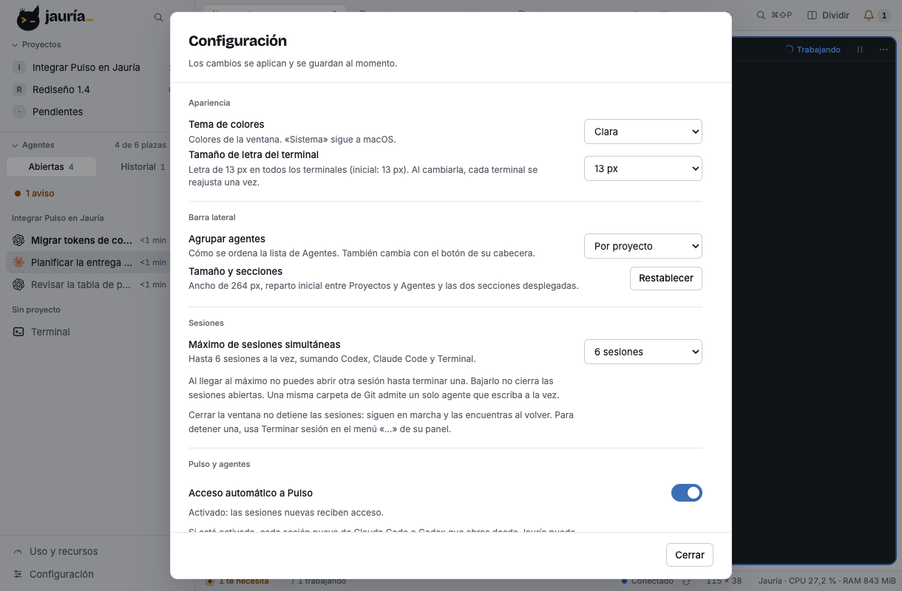
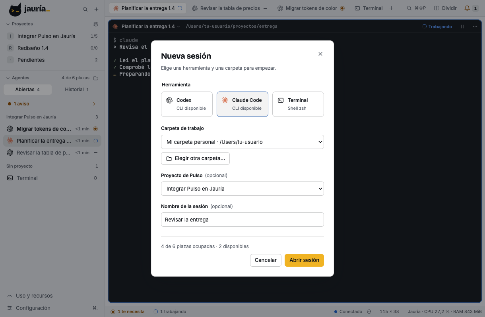
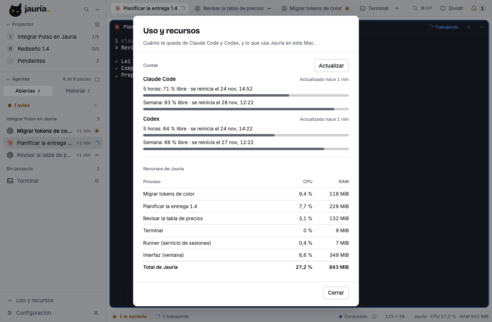

# Jauria — sesiones de Claude Code y Codex en macOS

<picture>
  <source media="(prefers-color-scheme: dark)" srcset="experiments/tauri-vertical/desktop/public/brand/jauria-logo-horizontal-oscuro.svg">
  
</picture>

[Español](README.md) · [English](README.en.md)

**Jauria is a macOS desktop session manager for Claude Code, OpenAI Codex and terminals, built with Tauri and Rust.**

Jauria es una aplicación de escritorio para macOS que reúne **Codex, Claude Code y terminales zsh**. Abre sesiones en cualquier carpeta, organízalas, consulta su historial y trabaja con dos paneles lado a lado. Puedes ejecutar hasta 8 sesiones simultáneas configurables; ver dos paneles no limita el número de sesiones abiertas. Para editar un mismo repositorio en paralelo, usa un worktree Git distinto por sesión.

**Versión 1.4.0 · macOS Apple Silicon · código GPLv3.** Consulta [VERSION](VERSION), el [changelog](CHANGELOG.md) y las [notas de 1.4.0](docs/RELEASE_1.4.0.md). La última release publicada en GitHub es la [1.4.0](https://github.com/StevenSantacruz56/jauria-sessions/releases/tag/v1.4.0). El DMG se publica sin firma Developer ID ni notarización; consulta sus límites antes de instalarlo.

Proyecto independiente, sin afiliación con OpenAI ni Anthropic.

> **Si vienes de 1.3.3:** esa app no puede guardar **Configuración** con su propio runner; 1.4.0 lo corrige (ver [CHANGELOG](CHANGELOG.md)).

## Para qué sirve

Para quien ya trabaja con las CLI de Codex o Claude Code y necesita mantener a mano la carpeta, el estado y la salida de cada sesión. Puedes abrir una sesión sin registrar un proyecto, consultar una sesión terminada o ver dos sesiones lado a lado. Para dos tareas de programación sobre un mismo repositorio, usa worktrees separados.

La opción **Terminal** abre una terminal normal con `/bin/zsh -il`, para ejecutar comandos como `pwd`, `git status` o las pruebas de tu proyecto. Carga la configuración de inicio de tu zsh y no requiere una CLI de IA.

Las sesiones interactivas de **Claude Code** cargan la configuración y los servidores MCP de tu cuenta y de la carpeta elegida, siguiendo las aprobaciones y la confianza de Claude. `/mcp` permite consultarlos. La prueba de diagnóstico permanece aislada, con MCP desactivados. Tras actualizar desde una versión que los desactivaba, abre una nueva sesión de Claude: los flags de un proceso ya iniciado no cambian.

Los permisos de las sesiones nativas se resuelven mediante la configuración de Claude Code o Codex de tu cuenta y de la carpeta elegida. Jauria no sustituye el modo de permisos ni copia aprobaciones entre proyectos. Las decisiones guardadas se reutilizan según su alcance; una autorización solo para la sesión puede volver a pedirse en otra. Los cambios del lanzador se aplican a sesiones nuevas, sin alterar procesos ya iniciados. Consulta [permisos y decisiones](docs/NATIVE_PERMISSIONS.md).

## Uso rápido

Con la aplicación abierta:

1. Pulsa **Nueva sesión** o `⌘N`.
2. Elige **Codex**, **Claude Code** o **Terminal** en Herramienta. Una CLI que no está instalada aparece deshabilitada, con **Comprobar otra vez**.
3. **Carpeta de trabajo**: viene **Mi carpeta personal**; elige otra con **Elegir otra carpeta…** o una de las cinco **Recientes**.
4. Opcional: un **Proyecto de Pulso** al que vincular la sesión y un **Nombre de la sesión**. Pulsa **Abrir sesión**. El pie dice cuántas plazas quedan y, si no se puede abrir, por qué.
5. En Codex o Claude Code, escribe tu petición y atiende los permisos que solicite la herramienta. En Terminal, ejecuta tus comandos habituales, por ejemplo:

   ```sh
   pwd
   git status  # si elegiste una carpeta dentro de un repositorio Git
   ```

Pulsa **Dividir** para mostrar dos paneles y elige una sesión distinta en el menú de cada uno. Dividir cambia la vista; no crea otra sesión. El selector separa **Abiertas** e **Historial**, y distingue las sesiones con nombres iguales por carpeta o identificador. El límite predeterminado es de **dos sesiones simultáneas** y puedes cambiarlo entre 1 y 8 en **Configuración…** (`⌘,`). El límite es compartido por los proveedores. Reducirlo no detiene sesiones abiertas. Las sesiones con estado incierto pueden seguir ocupando una plaza hasta resolverlas.

Pulsa `⌘⇧P` o el botón de búsqueda de la barra superior para abrir la **paleta de comandos**: escribe parte del nombre de una sesión, un tablero de Pulso o una acción (sin importar mayúsculas ni acentos; las iniciales también sirven) y pulsa Intro. Primero aparecen las sesiones que te necesitan. Las acciones que no están disponibles se muestran con el motivo. **Terminar** y **Cambiar nombre** abren su confirmación o formulario habitual, y **Cancelar (Ctrl-C)** solo enfoca su botón; la paleta nunca escribe en el terminal. Escape la cierra y devuelve el foco al terminal.

| Atajo | Acción |
| --- | --- |
| `⌘N` | Nueva sesión |
| `⌘⇧P` | Paleta de comandos |
| `⌘K` | Buscar en la lista de agentes |
| `⌘,` | Configuración |

El menú **«…»** de la cabecera del panel muestra la carpeta completa, el proveedor, el estado, el tamaño del terminal y el identificador de la sesión, y reúne **Copiar carpeta**, **Copiar identificador**, **Nueva sesión en esta carpeta…**, **Cambiar nombre…** y **Terminar sesión…**; en una sesión terminada, también **Eliminar salida guardada…** y **Compactar eventos antiguos…**. Se cierra al pulsar fuera, con Escape o al elegir una opción, como el resto de menús y listas flotantes. El nuevo nombre se guarda localmente y no modifica la conversación del proveedor.

**Terminar sesión…** pide confirmación; cuando el runner confirma el fin, el panel pasa a la siguiente sesión abierta (primero la que te necesita, después la que terminó sin ver, la que trabaja y la usada más recientemente) o a la bienvenida si no queda ninguna, y la sesión queda en **Historial** como **Terminada**. Si una sesión termina sola, el panel se queda en ella para que leas el final, con la etiqueta «Terminada · solo lectura» y el botón **Cerrar** en la cabecera. Si el fin no se puede confirmar, la cabecera dice «No se pudo confirmar el cierre».

La barra lateral tiene dos zonas con su propio desplazamiento: **Proyectos** y **Agentes**. Arrastra la línea entre ellas para repartir el espacio y el borde derecho para cambiar el ancho (de 220 a 420 px); con el teclado, enfoca el divisor y usa las flechas, Inicio/Fin e Intro (o doble clic) para volver al valor inicial. Un clic en el título de cada zona la pliega o despliega. Jauría recuerda el reparto, el ancho y lo plegado para cada perfil; **Restablecer tamaño de la barra lateral** (paleta o Configuración) vuelve al inicio. En ventanas de 860 px o menos la barra es un cajón de 264 px.

En **Configuración…** (`⌘,`) cada cambio se aplica y se guarda al momento; no hay botón Guardar. Secciones: **Apariencia** (tema y tamaño de letra del terminal, de 11 a 18 px), **Barra lateral** (agrupación de Agentes y restablecer tamaño), **Sesiones** (máximo de sesiones simultáneas), **Pulso y agentes** (acceso automático y acceso a mano para una sesión ya abierta), **Avisos** (avisos de macOS) y **Acerca de y diagnóstico** (versiones de la app y del runner, comprobación de Claude Code y Codex, diagnóstico revisable y **Reiniciar runner…**). El máximo de sesiones y el acceso automático se guardan en el perfil del runner; la apariencia, la letra y la barra lateral, en la interfaz local de este Mac (letra y barra lateral, por perfil).

Actualizar el código o reemplazar la app no actualiza un runner que ya está ejecutándose. Si **Configuración → Acerca de y diagnóstico** indica que las versiones no coinciden o que el runner es anterior, termina primero el trabajo activo y usa **Reiniciar runner…**. Las nuevas opciones de capacidad, renombrado y lanzamiento se habilitan con el runner actualizado; las preferencias nativas de permisos se aplican a sesiones nuevas.

## Pulso: un tablero por proyecto

Pulso presenta el trabajo en cuatro columnas fijas: **Por hacer, En curso, En espera y Hecho**. Cada proyecto tiene su pestaña; **Pendientes** es una pestaña fija para pendientes sin proyecto, incluidos los terminados.

1. En Pulso, pulsa **Nuevo proyecto** en la barra superior, junto a las pestañas de tableros. Escribe el nombre y confirma **Crear proyecto**. Si hay sesión actual, la casilla para usarla como principal aparece marcada; puedes marcar en su lugar **Empezar una sesión nueva para este proyecto**, que abre Nueva sesión y la deja como principal. El proyecto se abre como pestaña de tablero con la primera fase lista para escribir.
2. Usa **Añadir fase**, justo debajo de la última fase de cualquier columna. En Pendientes, la acción es **Añadir pendiente**.
3. Arrastra el agarre de una fase a otra columna o abre su menú **…** (Mover a Por hacer, En curso, En espera o Hecho), también con el teclado. Cambia el estado conservando el orden de fases; no hay reordenación dentro de una columna, columnas personalizadas ni traslado entre proyectos.
4. El título de una fase abre el drawer derecho; no inicia un PTY. Allí puedes editar título, notas y estado, consultar el último avance y siguiente paso, y desplegar **Guardar avance** para añadir un checkpoint inmutable. El historial carga 10 por página.
5. En la barra del proyecto, **Proyecto** edita el nombre y el plan opcional (se guardan solos) y **Sesiones** la sesión principal y los vínculos. Con todas las fases en Hecho aparece **Dar por terminado**, que archiva el proyecto (también se puede archivar sin terminar); **Histórico** lista los archivados, en solo lectura, y permite reabrirlos. El acceso automático a Pulso y los avisos de macOS se administran en **Configuración**. El tablero recuerda el último proyecto y ofrece **Abrir sesión principal**, **Continuar sesión principal** o **Abrir conversación activa**, según su estado.

Puedes volver directamente a una sesión viva, consultar su historial o editar y copiar contexto para abrir una sesión nueva vacía. Jauria no envía ese contexto al PTY. La reanudación Claude por ID reservado sigue siendo un intento sujeto al historial del proveedor y a los bloqueos existentes; Codex conserva terminal, historial y contexto, sin reanudación nativa. La CLI local mantiene permisos manuales acotados por proyecto y políticas revocables. La importación del Site y la sincronización en la nube siguen pendientes.

### Pulso con Claude Code y Codex

Pulso es el tablero local de proyectos, fases y avances de Jauría. Desde 1.3.3, las sesiones nuevas de Claude Code y Codex iniciadas desde Jauría reciben automáticamente el MCP `jauria-pulso` y acceso a todos los proyectos locales, incluida la creación. El interruptor **Configuración → Pulso y agentes → Acceso automático a Pulso** está activado por defecto y permite apagarlo. Cada sesión usa una credencial privada revocada al terminar; Jauría no cambia los permisos nativos de archivos, comandos o red.

Una conversación ya abierta no carga el MCP añadido después de iniciarse. Para continuar allí, usa **Configuración → Pulso y agentes → Dar o quitar acceso a una sesión ya abierta** y **Copiar instrucciones para el agente**. Ese texto incluye la ruta del permiso privado, pero no su token; compártelo únicamente en la conversación elegida. Las políticas manuales recordadas pueden acotar el acceso por proyecto, herramienta y carpeta. [Alcance y seguridad](docs/PULSO.md#privacidad-permisos-y-límites).

Cuando un programa emite explícitamente **OSC 7501**, la barra lateral, la pestaña y la cabecera del panel muestran su estado. Esta señal no cambia fases ni prueba que el trabajo esté validado. No se instalan hooks ni se modifica la configuración de los agentes. Sin emisión, la sesión aparece como **progreso no informado**, aunque su proceso siga abierto; el replay no genera estados ni avisos. Desde 1.4, con un runner 1.4, el runner lee esas señales y conserva el estado, la duración del turno y lo que ya viste: sobreviven a cerrar la ventana y reconectar. Con un runner 1.3.x la reconexión reinicia este estado efímero.

El tablero consulta un snapshot acotado con contadores y páginas por columna; no hay polling de Pulso oculto. Desde 1.4, con un runner 1.4, la barra lateral y el tablero se actualizan en un segundo o menos cuando un agente edita Pulso, y cada fase muestra en su pie la sesión vinculada y sus checkpoints; pulsarlo abre esa sesión. Se conservan los presupuestos locales de 1.1.0 y el respaldo consistente de SQLite. Consulta [la guía de Pulso](docs/PULSO.md), [la revisión de Herdr y decisiones](docs/HERDR_REVIEW.md), [las reglas de estados de 1.3.1](docs/RELEASE_1.3.1.md) y [las notas de 1.4.0](docs/RELEASE_1.4.0.md).

La release publicada **1.4.0** incluye un DMG verificado para Apple Silicon en GitHub Releases; sus pruebas y límites están en [sus notas](docs/RELEASE_1.4.0.md#verificación-de-la-entrega); las pruebas anteriores de Pulso, en [la validación de 1.3.0](docs/PULSO_VALIDATION_1.3.0.md). Las capturas utilizan datos sintéticos.

<picture>
  <source media="(prefers-color-scheme: dark)" srcset="docs/screenshots/pulso-1.4.0-oscuro.png">
  
</picture>

Tablero de ejemplo en Jauria 1.4.0. Captura sintética: no contiene sesiones ni tareas reales.



*Histórico: cada proyecto archivado dice si se terminó o se archivó con fases abiertas; «Reabrir» lo devuelve a sus pestañas.*

## Sesiones e historial

- **Sesión:** una ejecución en una carpeta. **Cancelar (Ctrl-C)** cancela lo que está haciendo; la sesión sigue abierta. **Terminar** detiene la sesión administrada y conserva archivos e historial; no revierte cambios.
- **Cuatro estados** (desde 1.4.0): **Abierta** (el agente está vivo y puedes escribirle), **Sin confirmar — ocupa plaza** (Jauría no puede asegurar que el proceso terminó; ocupa plaza hasta que uses **Liberar plaza…**), **Interrumpida** (terminó sin que lo pidieras: el runner se reinició o no llegó a iniciarse) y **Terminada** (la terminaste, terminó sola, o descartaste o continuaste una Interrumpida).
- **Ventana:** cerrarla o salir de la interfaz deja las sesiones en ejecución en el runner local. Si el runner se cae, sus sesiones quedan **Interrumpidas**: aparecen arriba de **Abiertas**, en la sección **Interrumpidas**, y no se reanudan solas.
- **Recuperar una Interrumpida:** al abrirla, el panel muestra encima del terminal (sin cambiar su tamaño) **Continuar conversación** (Claude Code con su identidad registrada; Codex estructurado con turnos) o **Empezar de nuevo aquí** (Codex en terminal, Terminal, o una sesión que no llegó a iniciarse), que abre Nueva sesión con la misma carpeta, herramienta y nombre. **Ver salida** pliega el aviso para leer el final y **Descartar** la pasa a Terminadas sin borrar nada. Continuar abre una sesión nueva en el mismo panel, sin pegar ni enviar texto; si la original estaba vinculada a un proyecto o una fase de Pulso, la nueva hereda ese vínculo y un aviso lo indica.
- **Historial:** solo Terminadas, de la más reciente a la más antigua (también Interrumpidas, selector y paleta). Elegir una abre la **vista Historial** en el lugar de los paneles, nunca un panel de trabajo: cabecera con proveedor, nombre, carpeta y estado; **Buscar en la salida**, **Copiar salida**, **Nueva sesión en esta carpeta**, **Continuar conversación** cuando la conversación lo permite, y en «…» **Borrar salida guardada…** y **Compactar eventos…**. **Volver a las sesiones** (o Escape) devuelve los paneles tal como estaban. El selector de un panel y **Dividir** solo ofrecen sesiones Abiertas, Interrumpidas que se pueden continuar y **Nueva sesión…**.

Jauria admite un solo escritor administrado por worktree Git: no abras dos sesiones que editen la misma copia. Usa un worktree por cada trabajo en paralelo. Terminal comparte estas restricciones y los bloqueos de recuperación. Estas protecciones no controlan procesos que abras por fuera de Jauria ni los cambios de carpeta que hagas dentro de una shell.

Desde 1.4 Jauria ya no incluye **Repositorios** ni tareas Git (registro de repositorios, worktree por tarea, revisión, verificación y relevo). Si tu perfil tiene datos de esa función de una versión anterior, se conservan en disco y se ignoran; Jauria no borra worktrees ni ramas. Puedes abrir una sesión normal en cualquiera de esas carpetas.

**Historial local parcial** indica que Jauria dejó de guardar salida al alcanzar su límite local. La sesión sigue funcionando y puedes escribir, interrumpirla o terminarla. La salida nueva puede faltar al reconectar. Este estado no indica que hayas agotado la cuota de Claude o Codex.

Con **Agentes → Por estado**, la barra lateral ordena las sesiones por acción requerida, avisos, turnos terminados, trabajo en curso y espera (las secciones de Actividad). La fila, la pestaña y la cabecera del panel muestran el estado declarado por el agente; mientras trabaja se indica desde cuándo lo informa. Una sesión abierta sin reporte queda marcada como progreso no informado. La **campana** de la barra superior reúne las causas pendientes y permite abrir la sesión; la barra de estado dice cuántas te necesitan, terminaron o trabajan. La campana y el Dock cuentan avisos sin ver. El fin de un turno sigue pendiente aunque el agente pase a `idle` (con un runner 1.4, también aunque empiece otro turno), hasta que abres la sesión; un bloqueo permanece visible mientras el agente lo declare. Marcar visto no resuelve un fallo ni concede permisos. Con un runner 1.4, al abrir la ventana lo pendiente aparece en la campana, la barra de estado y el Dock, pero macOS no notifica lo atrasado. Los avisos de macOS siguen siendo opcionales y usan textos sin nombres ni rutas. Consulta [las reglas y límites](docs/SESSION_ALERTS.md#actividad-y-avisos-desde-131) y [la interfaz con el runner](docs/SESSION_ALERTS.md#la-interfaz-con-el-runner-14-e).

<picture>
  <source media="(prefers-color-scheme: dark)" srcset="docs/screenshots/actividad-1.4.0-aviso-oscuro.png">
  
</picture>



*Capturas sintéticas de la interfaz: no contienen proyectos, sesiones ni rutas reales.*

## Preguntas frecuentes

### ¿Cómo gestionar sesiones de Claude Code y Codex en paralelo en Mac?

Abre una sesión por herramienta y carpeta desde Nueva sesión. Configuración permite un máximo combinado de 1 a 8 sesiones, con dos paneles de vista. Usa worktrees diferentes para dos tareas que escriban sobre el mismo repositorio Git.

### ¿Necesito crear un proyecto para cada sesión?

No. Puedes abrir sesiones en cualquier carpeta, incluida tu carpeta personal. En Nueva sesión, vincularla a un proyecto de Pulso es opcional. Los proyectos de Pulso organizan planes y fases sin exigir Git ni crear worktrees.

### ¿Jauria incluye el acceso a los modelos o aumenta sus cuotas?

Codex y Claude Code usan sus propias CLI, cuentas y límites. Jauria conserva la configuración nativa del proveedor; las cuotas de Claude o Codex son independientes del máximo de sesiones y del historial local.

### ¿Funciona en Windows, Linux o Mac Intel?

La distribución validada actualmente es macOS Apple Silicon. Esta entrega no ofrece soporte para Windows, Linux ni Intel.

### ¿Se puede citar o reutilizar este proyecto?

El código propio está bajo GPL-3.0-only, con condiciones separadas para terceros y marca. [CITATION.cff](CITATION.cff) proporciona la referencia del software; para citar una versión concreta, enlaza también su release. La [guía de descubrimiento](docs/DISCOVERABILITY.md) describe cómo preparar el contenido para búsqueda pública sin prometer indexación o recomendaciones de asistentes.

## Capturas

Las capturas de 1.4.0 usan el frontend real con datos sintéticos, sin perfiles, sesiones ni rutas de usuario, y se regeneran con `node tests/capture-docs.ts` (ver [las notas de 1.4.0](docs/RELEASE_1.4.0.md#capturas)).

<picture>
  <source media="(prefers-color-scheme: dark)" srcset="docs/screenshots/terminal-1.4.0-oscuro.png">
  
</picture>

*Barra lateral con Proyectos y Agentes, una pestaña por sesión abierta, la cabecera única del panel y la barra de estado.*

<picture>
  <source media="(prefers-color-scheme: dark)" srcset="docs/screenshots/paleta-1.4.0-oscuro.png">
  
</picture>

*Paleta de comandos (`⌘⇧P`): sesiones, proyectos de Pulso y acciones; las no disponibles muestran el motivo.*



*Configuración: apariencia, límite de sesiones, acceso automático a Pulso activado por defecto y permisos manuales en una sección desplegable.*



*Nueva sesión: herramienta, carpeta de trabajo (personal, otra o reciente), proyecto de Pulso opcional y nombre; el pie dice las plazas libres.*



*Uso y recursos: cuánto queda de cada cuota y qué usa cada sesión, el runner y la interfaz.*

## CPU, RAM y cuotas

**Uso y recursos** se abre desde el pie de la barra lateral, desde el total de la barra de estado o desde la paleta, en un diálogo propio. Arriba, las **cuotas** de Claude Code y Codex: por ventana, cuánto queda libre y cuándo se reinicia («Semana: 92 % libre · se reinicia el 25 nov, 11:23»). **Actualizar** consulta a Codex; nada se consulta al abrir. La cuota de Claude Code llega sola mientras hay una sesión de Claude abierta en Jauría; sin ella, la vista lo dice en una línea. Un dato viejo se marca «Dato vencido» con su antigüedad y no se presenta como vigente; no se inventa un saldo. Las cuotas del proveedor son distintas del límite local de sesiones simultáneas y de la cuota de almacenamiento del historial.

Debajo, los **recursos de Jauría**: una fila por sesión abierta con su nombre (sumando los procesos que lanzó), el runner, la interfaz y el **total**, que es la misma cifra de la barra de estado. La interfaz incluye los procesos del motor web de la ventana (WebKit) cuando macOS los atribuye a Jauría, que es lo normal al abrirla desde el Finder o el Dock; si no, la vista lo indica. La CPU se muestra como **porcentaje de la capacidad de todo el equipo** (1,25 núcleos ocupados en un Mac de 10 son un 12,5 %), y la barra de estado indica entre paréntesis cuánto de ese total es de las sesiones; con un runner y una ventana anteriores a este cambio se mantiene la escala antigua de 100 % por núcleo; la RAM suma la memoria en uso de cada proceso, que puede contar memoria compartida más de una vez. Son observaciones del momento, no requisitos mínimos ni promesas de rendimiento. Cómo se mide (método y fuentes) aparece en Configuración → Acerca de y diagnóstico.

## Requisitos

Esta entrega soporta **macOS en Apple Silicon**. Para compilar requiere Xcode Command Line Tools, Rust estable con soporte de edición 2024, Node.js 24 y npm, Git y Python 3.9 o posterior. Las versiones de dependencias están fijadas en los lockfiles. Los scripts descubren `cargo`, `rustc`, `node` y `npm` mediante `PATH` y conservan la configuración de herramientas del usuario.

Para sesiones reales, instala y autentica las CLI por separado. El backend actual espera Codex en `/opt/homebrew/bin/codex` y Claude Code en `~/.local/bin/claude`. No se promete compatibilidad con Intel ni con otras ubicaciones de Codex en este corte. Las cuentas, permisos y límites dependen del proveedor; Jauria no incluye credenciales.

## Instalar sin compilar

La instalación para otros usuarios se prepara como un archivo **`.dmg` para Apple Silicon**: abre la imagen y arrastra **Jauria** a **Aplicaciones**. Jauria no requiere instalar Rust ni Node para abrir la app; las CLI de los proveedores y su acceso se preparan por separado. Consulta [la guía de instalación](docs/INSTALLATION.md).

La [release v1.4.0](https://github.com/StevenSantacruz56/jauria-sessions/releases/tag/v1.4.0) incluye código fuente y `Jauria_1.4.0_aarch64_unsigned.dmg`, `SHA256SUMS` y el recibo JSON. Comprueba el checksum antes de instalar. La app incluida **no tiene firma Developer ID ni notarización**: macOS puede bloquear su apertura. No desactives Gatekeeper ni elimines la cuarentena; si se bloquea, espera una entrega firmada y notarizada. Consulta [la guía de instalación](docs/INSTALLATION.md).

## Compilar y abrir

Desde la raíz de un checkout limpio:

```sh
git clone https://github.com/StevenSantacruz56/jauria-sessions.git
cd jauria-sessions

xcode-select --install  # solo si faltan las herramientas de desarrollo
cargo --version
rustc --version
node --version
npm --version
python3 scripts/build-macos.py
python3 scripts/launch-macos.py --data "$HOME/Library/Application Support/Jauria-local"
```

La compilación instala dependencias npm con `npm ci`, construye el frontend, ejecuta tests locales de frontend y runner con fixtures temporales y las suites de navegador (requieren Google Chrome y Playwright WebKit: `npx playwright install webkit` en `experiments/tauri-vertical/desktop`; `--skip-browser-tests` las omite y lo indica), compila el runner release y crea una app de escritorio optimizada en modo release, sin firma de distribución ni notarización. La salida está en `experiments/tauri-vertical/desktop/src-tauri/target/release/bundle/macos/`. Para una compilación de desarrollo usa `--debug` tanto en el script de build como en el de apertura. Los nombres del bundle proceden de la configuración Tauri.

La estructura `experiments/tauri-vertical/{desktop,runner}` se conserva intencionalmente: desktop comparte módulos Rust mediante rutas relativas. No muevas esas carpetas por separado.

Consulta [desarrollo](docs/DEVELOPMENT.md), [privacidad y seguridad](SECURITY.md) y [contribuciones](CONTRIBUTING.md).

## Licencias y marca

El **código propio de Jauria está bajo GPLv3, versión 3 únicamente** (`GPL-3.0-only`): consulta [LICENSE](LICENSE). Al redistribuir binarios o modificaciones, cumple las condiciones de esa licencia y proporciona el código fuente correspondiente. La licencia no equivale a firma o notarización de macOS.

Los derechos sobre el nombre, logotipos y demás identidad de marca se mantienen separados. Las fuentes y bibliotecas conservan sus licencias originales. Consulta [NOTICE](NOTICE.md) y [las dependencias](docs/DEPENDENCIES.md).

La [revisión de exposición y dependencias](docs/PUBLICATION_READINESS.md) describe lo comprobado antes de hacer público el repositorio y los pendientes.

Las fuentes Bricolage Grotesque, Inter y JetBrains Mono incluyen sus textos OFL en `experiments/tauri-vertical/desktop/public/brand/fuentes/`. Los activos de marca mantienen sus bytes originales y metadatos de procedencia; los permisos sobre la marca son independientes de las licencias de fuentes y dependencias.
