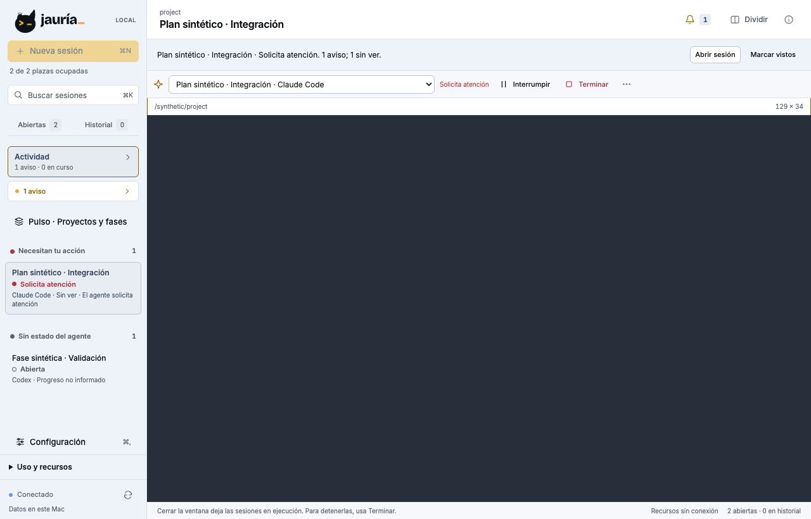
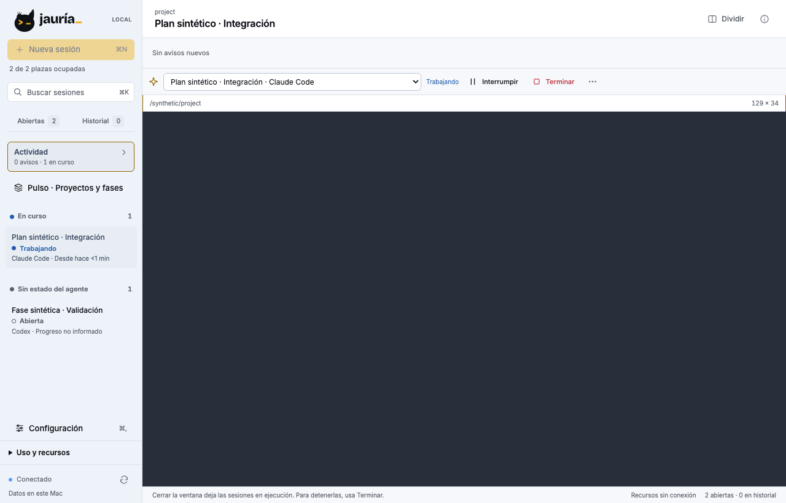
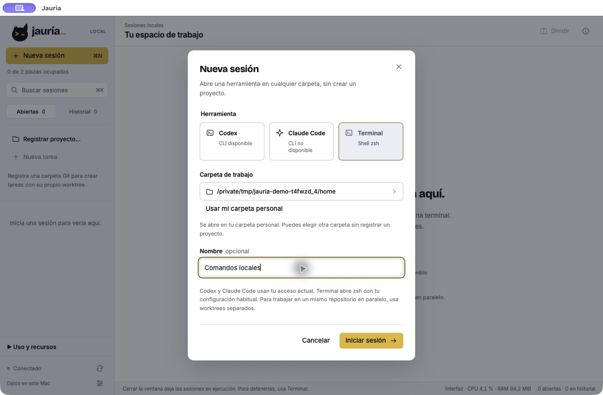
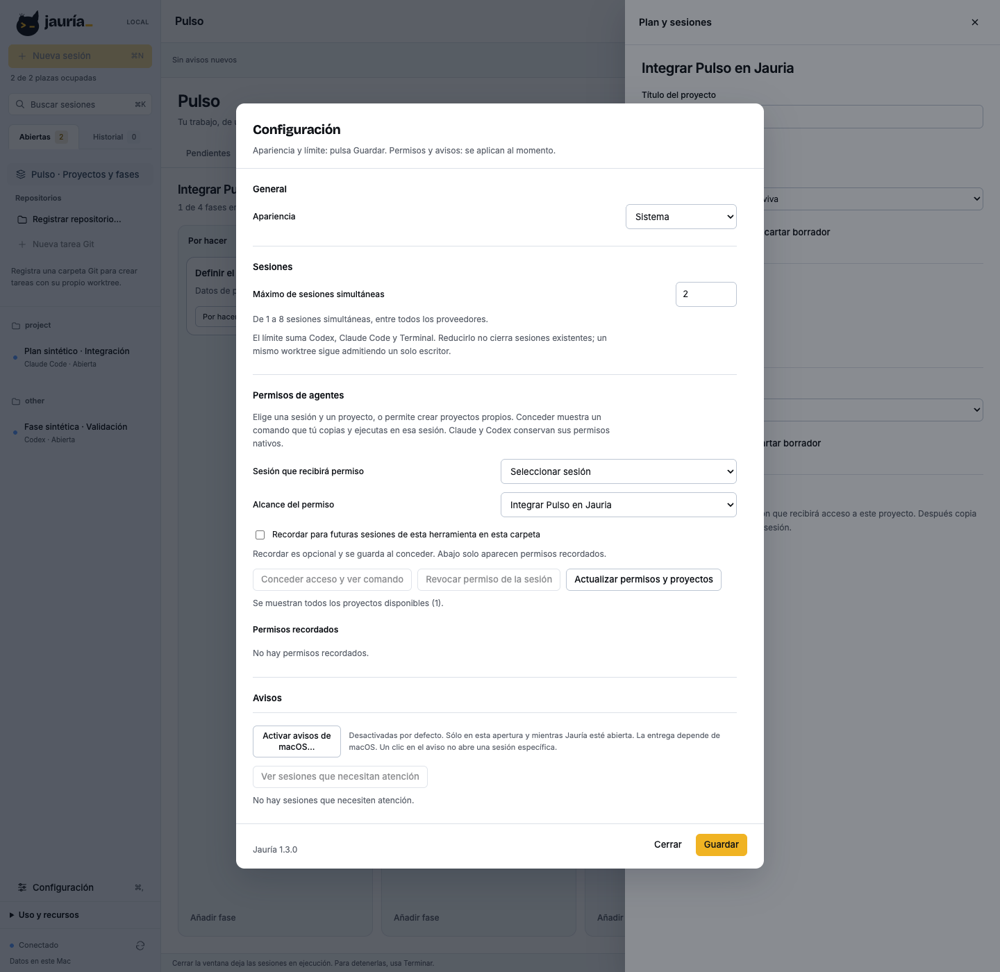

# Jauria — sesiones de Claude Code y Codex en macOS

<picture>
  <source media="(prefers-color-scheme: dark)" srcset="experiments/tauri-vertical/desktop/public/brand/jauria-logo-horizontal-oscuro.svg">
  
</picture>

[Español](README.md) · [English](README.en.md)

**Jauria is a macOS desktop session manager for Claude Code, OpenAI Codex and terminals, built with Tauri and Rust.**

Jauria es una aplicación de escritorio para macOS que reúne **Codex, Claude Code y terminales zsh**. Abre sesiones en cualquier carpeta, organízalas, consulta su historial y trabaja con dos paneles lado a lado. Puedes ejecutar hasta 8 sesiones simultáneas configurables; ver dos paneles no limita el número de sesiones abiertas. Para tareas Git en paralelo, prepara un worktree separado por tarea.

**Versión del código: 1.3.1 · macOS Apple Silicon · código GPLv3.** Consulta [VERSION](VERSION), el [changelog](CHANGELOG.md) y las [notas de 1.3.1](docs/RELEASE_1.3.1.md). Las releases publicadas en GitHub llegan hasta 1.0.1; los instaladores recientes se preparan localmente, sin firma Developer ID ni notarización.

Proyecto independiente, sin afiliación con OpenAI ni Anthropic.

## Para qué sirve

Para quien ya trabaja con las CLI de Codex o Claude Code y necesita mantener a mano la carpeta, el estado y la salida de cada sesión. Puedes abrir una sesión sin registrar un proyecto, consultar una sesión terminada o ver dos sesiones lado a lado. Para dos tareas de programación sobre un mismo repositorio, usa worktrees separados.

La opción **Terminal** abre una terminal normal con `/bin/zsh -il`, para ejecutar comandos como `pwd`, `git status` o las pruebas de tu proyecto. Carga la configuración de inicio de tu zsh y no requiere una CLI de IA.

Las sesiones interactivas de **Claude Code** cargan la configuración y los servidores MCP de tu cuenta y de la carpeta elegida, siguiendo las aprobaciones y la confianza de Claude. `/mcp` permite consultarlos. La prueba de diagnóstico permanece aislada, con MCP desactivados. Tras actualizar desde una versión que los desactivaba, abre una nueva sesión de Claude: los flags de un proceso ya iniciado no cambian.

Los permisos de las sesiones nativas se resuelven mediante la configuración de Claude Code o Codex de tu cuenta y de la carpeta elegida. Jauria no sustituye el modo de permisos ni copia aprobaciones entre proyectos. Las decisiones guardadas se reutilizan según su alcance; una autorización solo para la sesión puede volver a pedirse en otra. Los cambios del lanzador se aplican a sesiones nuevas, sin alterar procesos ya iniciados. Consulta [permisos y decisiones](docs/NATIVE_PERMISSIONS.md).

## Uso rápido

Con la aplicación abierta:

1. Pulsa **Nueva sesión** o `⌘N`.
2. Elige **Codex**, **Claude Code** o **Terminal** en Herramienta.
3. La carpeta personal viene seleccionada. Elige otra **Carpeta de trabajo** si lo necesitas; puedes volver con **Usar mi carpeta personal**. No hace falta registrar un proyecto.
4. Añade un **Nombre** opcional y pulsa **Iniciar sesión**.
5. En Codex o Claude Code, escribe tu petición y atiende los permisos que solicite la herramienta. En Terminal, ejecuta tus comandos habituales, por ejemplo:

   ```sh
   pwd
   git status  # si elegiste una carpeta dentro de un repositorio Git
   ```

Pulsa **Dividir** para mostrar dos paneles y elige una sesión distinta en el menú de cada uno. Dividir cambia la vista; no crea otra sesión. El selector separa **Abiertas** e **Historial**, y distingue las sesiones con nombres iguales por carpeta o identificador. El límite predeterminado es de **dos sesiones simultáneas** y puedes cambiarlo entre 1 y 8 en **Configuración…** (`⌘,`). El límite es compartido por los proveedores. Reducirlo no detiene sesiones abiertas. Las sesiones con estado incierto pueden seguir ocupando una plaza hasta resolverlas.

Abre **Acciones de la sesión → Cambiar nombre…** en el menú de los tres puntos del panel para cambiar el nombre de una sesión activa o del historial. El nuevo nombre se guarda localmente y no modifica la conversación del proveedor.

En **Configuración…** puedes elegir la apariencia y el máximo de sesiones. El cambio de capacidad se aplica a los próximos inicios; se mantienen las protecciones de worktree. La apariencia se guarda para la interfaz local; la capacidad se guarda en el perfil del runner.

Actualizar el código o reemplazar la app no actualiza un runner que ya está ejecutándose. Si Información → Diagnóstico indica un runner anterior, termina primero el trabajo activo y usa **Reiniciar runner…**. Las nuevas opciones de capacidad, renombrado y lanzamiento se habilitan con el runner actualizado; las preferencias nativas de permisos se aplican a sesiones nuevas.

## Pulso: un tablero por proyecto

Pulso 1.3.0 presenta el trabajo en cuatro columnas fijas: **Por hacer, En curso, En espera y Hecho**. Cada proyecto tiene su pestaña; **Pendientes** es una pestaña fija para tarjetas sin proyecto, incluidas las terminadas. **Repositorios** conserva aparte el trabajo Git.

1. Pulsa **Nuevo proyecto**, escribe el nombre y confirma **Crear proyecto**. Si hay sesión actual, la casilla para usarla como principal aparece marcada; puedes desmarcarla. El proyecto se abre como pestaña de tablero.
2. Usa **Añadir fase** dentro de cualquiera de las tres primeras columnas. En Pendientes, la acción es **Añadir pendiente**.
3. Arrastra el agarre de una tarjeta a otra columna o usa el selector **Mover** con el teclado. Cambia el estado conservando el orden de fases; no hay reordenación dentro de una columna, columnas personalizadas ni traslado entre proyectos.
4. **Abrir** en una tarjeta muestra el drawer derecho; no inicia un PTY. Allí puedes editar título, notas y estado, consultar el último avance y siguiente paso, y desplegar **Guardar avance** para añadir un checkpoint inmutable. El historial carga 10 por página.
5. **Plan y sesiones**, en la barra del proyecto, abre el plan opcional, la sesión principal y los vínculos. Los permisos y los avisos de macOS se administran en **Configuración**. El tablero recuerda el último proyecto y ofrece **Abrir sesión principal**, **Reanudar sesión principal** o **Abrir conversación activa**, según su estado. Al configurar permisos, elige expresamente la sesión y el alcance; crear proyectos propios no es el valor inicial.

Puedes volver directamente a una sesión viva, consultar su historial o editar y copiar contexto para abrir una sesión nueva vacía. Jauria no envía ese contexto al PTY. La reanudación Claude por ID reservado sigue siendo un intento sujeto al historial del proveedor y a los bloqueos existentes; Codex conserva terminal, historial y contexto, sin reanudación nativa. La CLI local mantiene permisos explícitos acotados por proyecto y políticas revocables. El runner 1.3.0 incluye un MCP local opcional; la importación del Site y la sincronización en la nube siguen pendientes.

### Pulso con Claude Code

Pulso es el tablero local de proyectos, fases y avances de Jauria. El MCP `jauria-pulso` ofrece ocho herramientas para consultar y registrar ese trabajo; **no viene conectado automáticamente a Claude Code ni concede permisos al registrarlo**. Para habilitarlo en sesiones nuevas, sigue [la configuración de Claude Code](docs/PULSO.md#mcp-local-opcional-para-nuevas-sesiones). Después abre una sesión nueva desde Jauria, comprueba `/mcp` y, en **Configuración → Permisos de agentes**, elige esa sesión y un proyecto concreto o **Crear proyectos propios**. La opción de recordar acceso empieza desmarcada.

Una conversación de Claude ya abierta no carga el MCP añadido después de iniciarse. Para continuar allí, concede acceso a esa sesión y usa **Copiar instrucciones para el agente**: el comando local funciona sin MCP. Ese texto incluye la ruta del permiso privado, pero no su token; compártelo únicamente en la conversación elegida. El MCP de Claude Code es distinto de los conectores de Claude Desktop. [Alcance y seguridad](docs/PULSO.md#privacidad-permisos-y-límites).

Cuando un programa emite explícitamente **OSC 7501**, la vista viva y **Actividad** muestran su estado. Esta señal no cambia fases ni prueba que el trabajo esté validado. No se instalan hooks ni se modifica la configuración de los agentes. Sin emisión, la sesión aparece como **progreso no informado**, aunque su proceso siga abierto; el replay no genera estados ni avisos y la reconexión reinicia este estado efímero.

El tablero consulta un snapshot acotado con contadores y páginas por columna; no hay polling de Pulso oculto. Se conservan los presupuestos locales de 1.1.0 y el respaldo consistente de SQLite. Consulta [la guía de Pulso](docs/PULSO.md), [la revisión de Herdr y decisiones](docs/HERDR_REVIEW.md) y [la entrega 1.3.1](docs/RELEASE_1.3.1.md).

La entrega local **1.3.1** está compilada y su DMG verificado. Consulta [las pruebas y límites de esta versión](docs/RELEASE_1.3.1.md) y [las pruebas anteriores de Pulso](docs/PULSO_VALIDATION_1.3.0.md). La vista de ejemplo utiliza otro perfil; no se sustituyeron sesiones del perfil habitual ni se publicó este instalador.


Tablero de ejemplo en Jauria 1.3.0. Captura sintética: no contiene sesiones ni tareas reales.

## Sesiones, repositorios e historial

- **Sesión:** una ejecución en una carpeta. **Interrumpir (Ctrl-C)** interrumpe el trabajo actual, sin garantizar que termine la sesión. **Terminar** detiene la sesión administrada y conserva archivos e historial; no revierte cambios.
- **Ventana:** cerrarla o salir de la interfaz deja las sesiones en ejecución en el runner local. Si el runner termina, las sesiones no se reanudan automáticamente. Vuelve a abrir con el mismo perfil de datos para consultar su estado e historial.
- **Historial:** la salida guardada de sesiones terminadas se consulta en solo lectura; seleccionarla no reinicia el proceso. En Información puedes eliminar salida o compactar eventos de sesiones finalizadas.
- **Repositorio Git:** registra una carpeta Git para organizar tareas técnicas, independiente de los proyectos de plan de Pulso. Usa **Registrar repositorio…**, **Nueva tarea Git** y **Preparar worktree** antes de iniciar el proveedor desde la tarea. Cerrar una sesión no completa la tarea. **Cerrar proyecto** lo oculta conservando tareas, archivos e historial; puede bloquearse mientras haya trabajo pendiente. Puedes volver desde **Repositorios cerrados → Reabrir**.

Jauria admite un solo escritor administrado por worktree Git: no abras dos sesiones que editen la misma copia. Usa un worktree por tarea paralela. Terminal comparte estas restricciones y los bloqueos de recuperación y verificación. Estas protecciones no controlan procesos que abras por fuera de Jauria ni los cambios de carpeta que hagas dentro de una shell.

**Historial local parcial** indica que Jauria dejó de guardar salida al alcanzar su límite local. La sesión sigue funcionando y puedes escribir, interrumpirla o terminarla. La salida nueva puede faltar al reconectar. Este estado no indica que hayas agotado la cuota de Claude o Codex.

**Actividad** ordena las sesiones por acción requerida, avisos, turnos terminados, trabajo en curso y espera. La fila y la cabecera del terminal muestran el estado declarado por el agente; mientras trabaja se indica desde cuándo lo informa. Una sesión abierta sin reporte queda marcada como progreso no informado. **Avisos** reúne las causas pendientes y permite abrir la sesión desde la barra superior. La campana y el Dock cuentan avisos sin ver. El fin de un turno sigue pendiente aunque el agente pase a `idle`, hasta que abres la sesión; un bloqueo permanece visible mientras el agente lo declare. Marcar visto no resuelve un fallo ni concede permisos. Los avisos de macOS siguen siendo opcionales y usan textos sin nombres ni rutas. Consulta [las reglas y límites](docs/SESSION_ALERTS.md#actividad-y-avisos-desde-131).





*Capturas sintéticas de la interfaz: no contienen proyectos, sesiones ni rutas reales.*

## Preguntas frecuentes

### ¿Cómo gestionar sesiones de Claude Code y Codex en paralelo en Mac?

Abre una sesión por herramienta y carpeta desde Nueva sesión. Configuración permite un máximo combinado de 1 a 8 sesiones, con dos paneles de vista. Usa worktrees diferentes para dos tareas que escriban sobre el mismo repositorio Git.

### ¿Necesito crear un proyecto para cada sesión?

Puedes iniciar sesiones en cualquier carpeta, incluida tu carpeta personal, sin registrar un proyecto. Los repositorios y tareas Git sirven para trabajo con carpetas aisladas; los proyectos de Pulso organizan planes y fases sin exigir Git.

### ¿Jauria incluye el acceso a los modelos o aumenta sus cuotas?

Codex y Claude Code usan sus propias CLI, cuentas y límites. Jauria conserva la configuración nativa del proveedor; las cuotas de Claude o Codex son independientes del máximo de sesiones y del historial local.

### ¿Funciona en Windows, Linux o Mac Intel?

La distribución validada actualmente es macOS Apple Silicon. Esta entrega no ofrece soporte para Windows, Linux ni Intel.

### ¿Se puede citar o reutilizar este proyecto?

El código propio está bajo GPL-3.0-only, con condiciones separadas para terceros y marca. [CITATION.cff](CITATION.cff) proporciona la referencia del software; para citar una versión concreta, enlaza también su release. La [guía de descubrimiento](docs/DISCOVERABILITY.md) describe cómo preparar el contenido para búsqueda pública sin prometer indexación o recomendaciones de asistentes.

## Capturas

Las dos primeras capturas muestran la aplicación en macOS con sesiones temporales de demostración. Las vistas de Configuración de 1.3.0 y pestañas de 1.0.0 usan los componentes reales de la interfaz con datos sintéticos, sin perfiles de usuario.



*Nueva sesión: selección de herramienta, carpeta y nombre opcional en una demostración propia.*


*Terminal dividida: dos sesiones de demostración visibles lado a lado, sin datos de usuarios.*



*Configuración: apariencia, límite combinado de 1 a 8 sesiones, permisos y avisos. Vista sintética de la interfaz.*


*Pestaña activa elevada y contadores separados; el selector del panel distingue abiertas e historial.*

## CPU, RAM y cuotas

**Uso y recursos** muestra procesos observados de la interfaz, el runner, las CLI y sus hijos. No garantiza el consumo total: puede excluir servicios reparentados y procesos WebKit no atribuibles. El pie de ventana resume el proceso de interfaz.

La CPU usa **100 % por núcleo** y puede superar ese valor; la primera muestra queda pendiente. La RAM es **RSS residente**, que puede contar memoria compartida más de una vez. Son observaciones del momento, no requisitos mínimos ni promesas de rendimiento.

**Actualizar cuotas** consulta las ventanas informadas por Codex. Para Claude Code se usan datos de la barra de estado de una sesión nativa compatible, cuando los entregue tras una respuesta. Si faltan datos, están vencidos o falla la consulta, la interfaz lo indica: no se inventa un saldo. Las cuotas del proveedor son distintas del límite local de sesiones simultáneas y de la cuota de almacenamiento del historial.

## Requisitos

Esta entrega soporta **macOS en Apple Silicon**. Para compilar requiere Xcode Command Line Tools, Rust estable con soporte de edición 2024, Node.js 24 y npm, Git y Python 3.9 o posterior. Las versiones de dependencias están fijadas en los lockfiles. Los scripts descubren `cargo`, `rustc`, `node` y `npm` mediante `PATH` y conservan la configuración de herramientas del usuario.

Para sesiones reales, instala y autentica las CLI por separado. El backend actual espera Codex en `/opt/homebrew/bin/codex` y Claude Code en `~/.local/bin/claude`. No se promete compatibilidad con Intel ni con otras ubicaciones de Codex en este corte. Las cuentas, permisos y límites dependen del proveedor; Jauria no incluye credenciales.

## Instalar sin compilar

La instalación para otros usuarios se prepara como un archivo **`.dmg` para Apple Silicon**: abre la imagen y arrastra **Jauria** a **Aplicaciones**. Jauria no requiere instalar Rust ni Node para abrir la app; las CLI de los proveedores y su acceso se preparan por separado. Consulta [la guía de instalación](docs/INSTALLATION.md).

Las releases actuales de GitHub contienen **código y documentación hasta 1.0.1**; el DMG 1.3.1 se conserva como **instalador local**, sin adjuntarlo a una release. Cada paquete usa su versión en el nombre: `Jauria_<versión>_aarch64_unsigned.dmg`, acompañado de `SHA256SUMS` y un recibo de verificación. No hay un DMG 1.3.1 descargable desde GitHub en esta entrega. El repositorio de código es público. La distribución con firma Developer ID y notarización queda pendiente; no cambies protecciones de macOS para instalarlo.

## Compilar y abrir

Desde la raíz de un checkout limpio:

```sh
git clone https://github.com/StevenSantacruz56/jauria-sessions.git
cd jauria-sessions

xcode-select --install  # solo si faltan las herramientas de desarrollo
cargo --version
rustc --version
node --version
npm --version
python3 scripts/build-macos.py
python3 scripts/launch-macos.py --data "$HOME/Library/Application Support/Jauria-local"
```

La compilación instala dependencias npm con `npm ci`, construye el frontend, ejecuta tests locales de frontend y runner con fixtures temporales, compila el runner release y crea una app de escritorio optimizada en modo release, sin firma de distribución ni notarización. La salida está en `experiments/tauri-vertical/desktop/src-tauri/target/release/bundle/macos/`. Para una compilación de desarrollo usa `--debug` tanto en el script de build como en el de apertura. Los nombres del bundle proceden de la configuración Tauri.

La estructura `experiments/tauri-vertical/{desktop,runner}` se conserva intencionalmente: desktop comparte módulos Rust mediante rutas relativas. No muevas esas carpetas por separado.

Consulta [desarrollo](docs/DEVELOPMENT.md), [privacidad y seguridad](SECURITY.md) y [contribuciones](CONTRIBUTING.md).

## Licencias y marca

El **código propio de Jauria está bajo GPLv3, versión 3 únicamente** (`GPL-3.0-only`): consulta [LICENSE](LICENSE). Al redistribuir binarios o modificaciones, cumple las condiciones de esa licencia y proporciona el código fuente correspondiente. La licencia no equivale a firma o notarización de macOS.

Los derechos sobre el nombre, logotipos y demás identidad de marca se mantienen separados. Las fuentes y bibliotecas conservan sus licencias originales. Consulta [NOTICE](NOTICE.md) y [las dependencias](docs/DEPENDENCIES.md).

La [revisión de exposición y dependencias](docs/PUBLICATION_READINESS.md) describe lo comprobado antes de hacer público el repositorio y los pendientes.

Las fuentes Bricolage Grotesque, Inter y JetBrains Mono incluyen sus textos OFL en `experiments/tauri-vertical/desktop/public/brand/fuentes/`. Los activos de marca mantienen sus bytes originales y metadatos de procedencia; los permisos sobre la marca son independientes de las licencias de fuentes y dependencias.
