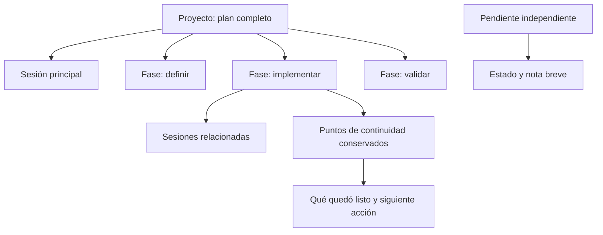
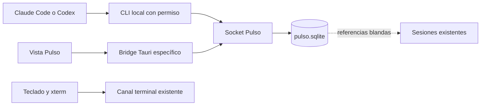

# Pulso dentro de Jauria: proyectos, fases y continuidad

Fecha: 2026-11-14. Alcance de implementación: 1.1.0 local, macOS Apple Silicon. Base de Jauria `70e7c96`; fuente de referencia Pulso `21b9f6fa8f5b65a2a95934f14b7d18461e80227d`.

Este documento reemplaza la propuesta inicial de una agenda genérica. La aclaración del usuario fija **una sola app**, un plan completo como proyecto y recuperación desde su sesión o una fase. Las funciones y límites de uso están en [PULSO.md](PULSO.md).

## Resultado acordado con Claude Code

Un proyecto contiene el plan completo y fases ordenadas. Tiene una sesión principal explícita, donde se elaboró el plan, y puede vincular otras sesiones al proyecto o a una fase. Un pendiente suelto no requiere proyecto. Jira mantiene el detalle de requisitos y el seguimiento de equipo.

El proyecto de planificación es distinto de un repositorio Git. No se requiere repositorio, no se crea un worktree al capturar un plan y no se inicia un agente al mover una fase. La navegación anterior se identifica como Repositorios/tareas Git.

### Jerarquía

No se añade un tercer nivel de subtareas. La fase es un item con proyecto; un item sin proyecto es un pendiente independiente. Las fases no son snapshots de la conversación ni del repositorio.

## Flujo de uso

1. Comenzar el plan en Claude o Codex como siempre.
2. Crear un proyecto en Pulso: la casilla de sesión principal captura la sesión actual por defecto cuando está disponible. Se puede desmarcar o cambiar la principal después; el texto del plan es opcional.
3. Crear las fases en el orden del trabajo, manualmente o con el agente autorizado.
4. Registrar un punto de continuidad antes de dejar una fase: qué quedó listo, siguiente acción y sesión relacionada.
5. Al volver, abrir el proyecto, elegir la fase y volver a su sesión o revisar el contexto guardado.

Estados: **Por hacer / En curso / En espera / Hecho**. Un agente autorizado puede mover explícitamente a Hecho. Eso no equivale a verificación, aceptación de código o merge; el workflow técnico conserva sus garantías independientes.

El usuario no tiene que repetir una especificación de Jira para capturar una tarea. No hay extracción continua de planes mediante parsing del terminal: la CLI del agente registra estructuras explícitas, evitando interpretar redibujos de la TUI como instrucciones o estados.

## Recuperación honesta

| Caso | Acción | Invariante |
| --- | --- | --- |
| Sesión viva | Enfocar la misma terminal | Sin nuevo proceso, sin duplicar escritor. |
| Sesión terminada | Ver historial local | Solo lectura; la salida puede ser parcial por retención. |
| Fase con continuidad guardada | Preparar contexto editable y copiar | Nunca se pega ni se envía automáticamente. Nueva sesión vacía elegida por el usuario. |
| Conversación Claude con ID reservado por Jauria | Intentar reanudar ese ID exacto | UUID reservado no prueba que el proveedor guardó historial; error visible, sin `--last` ni fallback. |
| Conversación nativa Codex sin ID determinista | Historial, sesión viva o contexto de fase | No adivinar por carpeta, título o última conversación. Codex permanece en terminal. |

La sesión principal se conserva aunque termine. Ninguna sesión auxiliar es promovida automáticamente. Si la misma conversación ya tiene una continuación administrada viva, **Volver a conversación reanudada** la enfoca. Al intentar reanudar se conservan los metadatos de origen y se vincula la nueva sesión al proyecto/fase seleccionado; un fallo del vínculo se comunica para completarlo manualmente. Reanudar una conversación continúa su estado actual; no rebobina hasta la fase elegida.

## Arquitectura implementada

- Frontend TypeScript y estilos existentes. No se introduce React/Vinext ni un servidor web dentro del desktop.
- Mismo runner Rust; `pulso.sqlite`, conexión y mutex propios. No se modifica la versión core de SQLite.
- Socket Unix Pulso privado y cupo independiente de ocho clientes; el canal core conserva su propio cupo.
- Credencial de UI Pulso diferente del token del core. La CLI usa un archivo de permiso de sesión, no el token de administración.
- Links de proyecto/fase a sesión sin FK entre bases, sin `ATTACH`, sin transacción distribuida y sin efectos sobre procesos o Git.
- Migración/apertura fallida del módulo conserva sus datos y deja las terminales disponibles. La app detecta un daemon anterior sin reiniciarlo.
- La primera integración de agentes usa CLI JSON. MCP queda pendiente y no se declara entregado.

### Dominio y contratos

Proyectos con título, plan opcional hasta 32.000 caracteres, sesión principal, revisión y marcas temporales. Items con título hasta 240, nota hasta 1.000, estado y posición. Checkpoints inmutables con resumen hasta 4.000 y siguiente acción hasta 1.000. Actividad y recibos idempotentes separados del historial terminal.

Crear usa un ID estable generado por el cliente y un requestId. Editar requiere revisión esperada. Transacción: documento + actividad + recibo + revisión global. El principal de la concesión permanece independiente del token que se renueva. Repetir el mismo comando tras un resultado incierto devuelve su recibo; cambiar el contenido con el mismo requestId falla. Se reevalúa el alcance antes de reproducir recibos.

Proyectos e items se filtran y paginan en SQL con cursor numérico, límite predeterminado 50 y máximo 100; no se cargan todos los registros para recortar una página en memoria. Las listas de proyectos devuelven resúmenes; el plan completo se obtiene solo con `project{id}`. El detalle de un item devuelve los 10 checkpoints más recientes; `checkpoint_history` y **Ver puntos anteriores** recuperan páginas anteriores de hasta 10. Los vínculos consultados en cada detalle están acotados a 100. Peticiones y respuestas tienen límite de bytes además de los límites por campo.

El presupuesto lógico es de 64 MiB o 100.000 filas e incluye documentos, actividad, recibos, principales de permisos y políticas. Solo principales/políticas pueden usar el margen adicional de 1 MiB/2.000 filas; no amplía el presupuesto de datos. La base Pulso tiene un límite físico de 128 MiB mediante `max_page_count`, no una cuota global para el perfil. Al alcanzar el presupuesto siguen disponibles las lecturas; el crecimiento que lo excede se rechaza. No hay eliminación automática ni exportación/restauración desde UI. El [respaldo manual](PULSO.md#respaldo-local) usa una copia consistente de SQLite, nunca una copia cruda del archivo abierto.

La reanudación nativa usa reservas de identidad independientes de la retención de salida. Se reservan antes de lanzar Claude, se preservan a través de reanudaciones y se bloquea otra sesión administrada activa o incierta del mismo proveedor/UUID, incluso fuera de Git. Un reintento de lanzamiento devuelve la sesión ya creada antes de repetir validaciones o efectos.

## Seguridad y acceso de agentes

El acceso inicia desactivado. La UI puede conceder escritura a un proyecto concreto y bootstrap para proyectos creados por esa misma sesión. No se exponen automáticamente otros proyectos ni pendientes independientes. El servidor deriva actor y sesión del permiso; no confía en campos enviados por el cliente.

Las políticas se recuerdan solo con una casilla explícita, inicialmente desmarcada, por proveedor/ruta canónica, y se gestionan desde el bloque de acceso. Una política guardada emite credenciales nuevas para sesiones futuras, no mantiene vivo el token de una sesión terminada.

- Comprobación de sesión viva y epoch antes y después de acceder al estado Pulso.
- Revocación rápida en memoria al detener y al finalizar; no espera SQLite.
- La carga automática de política ocurre en segundo plano después de iniciar el lector y el waiter del PTY. No bloquea la admisión ni la salida del hijo.
- Las políticas tienen una identidad de generación: borrarlas y crear otra igual no resucita tokens antiguos. Cambiar el alcance invalida permisos dependientes de la configuración anterior.
- Recibos y actividad son duraderos; no hay cola oculta de acciones que se envíen al reconectar.
- Archivos privados, sin seguir enlaces inesperados; misma identidad de usuario comprobada en el socket.
- Deadline de lectura y presupuesto total de respuesta para no retener trabajadores con clientes lentos. Errores transitorios de aceptación no apagan el listener.

Esto evita errores de alcance y permite atribuir/revocar el canal normal. No es aislamiento frente a procesos hostiles con el mismo usuario de macOS; tampoco lo son los worktrees. Un principal de app no prueba que una persona haya hecho clic. Los permisos nativos de Claude/Codex se conservan.

El contenido que lee una sesión puede llegar al proveedor de ese agente. No se inyecta toda la agenda en sus prompts ni se copian transcripciones completas a los checkpoints. Los IDs del API son globalmente únicos; las guías recomiendan UUID, no reutilizar identificadores literales de ejemplo.

## Usabilidad y fluidez

Una vista central extiende la identidad existente de Jauria. No hay tablero permanente que estreche las terminales. La lista prioriza título, fase y estado; plan, permisos y continuidad se muestran en contexto.

- Mantener las mismas instancias xterm, panes, scroll y borradores.
- Nunca ejecutar fit ni resize con la vista terminal oculta/0×0.
- Al volver, cero resizes si no cambió el tamaño; uno válido si cambió.
- Refresco de revisión cada dos segundos solo con Pulso visible y documento visible, independiente del loop PTY/status. Sin consulta por tarjeta.
- Borrador y caret sobreviven a cambios remotos; un conflicto necesita revisión explícita, no sobrescritura automática.
- Deshacer un cambio de estado exige la revisión resultante; no revierte ediciones posteriores de otro actor.
- El control de revocación permanece disponible después de un refresco de datos.
- Cambios rutinarios no se convierten en avisos nuevos ni aumentan el badge.

La aceptación de latencia usa mediciones A/B de fixtures release, no sensaciones ni métricas de llamadas remotas al modelo. Se mide entrega de input/eco y controles, complementada con conservación de xterm/scroll en Chromium y WebKit. El eco del proceso no mide por sí solo la pintura de pantalla.

## Etapas de esta entrega

| Etapa | Entregable |
| --- | --- |
| P0 | Recuperar fuente Pulso, debatir jerarquía y límites con Claude; medir base del runner. |
| P1 | Dominio, almacenamiento independiente, revisiones, recibos y continuidad inmutable. |
| P2 | Socket, credenciales, CLI y políticas; degradación independiente del core. |
| P3 | Vista de proyectos/fases, vínculos y contexto manual; conservación de terminales. |
| P4 | Reservas nativas Claude, reanudación exacta y fences de escritor/conversación. |
| P5 | Pruebas cruzadas, endurecimiento, comparación de carga, documentación e instalador local. |

P0–P5 completadas para esta entrega local. Los resultados, las métricas y la verificación del paquete se registran en [la validación de 1.1.0](PULSO_VALIDATION_1.1.0.md). No interpretar este plan como afirmación de que un adaptador MCP, una importación o la reanudación nativa Codex existen.

## Pruebas necesarias y evidencia

- `runner/src/pulso.rs`: alcance, políticas, revocación, reintentos, conflictos, corrupción, límites, permisos de archivos y clientes lentos.
- `runner/src/native_sessions.rs`: UUID, reservas duraderas, enlaces, identidad y publicación sin reemplazar otra reserva.
- `runner/tests/pulso_rpc.rs`: contrato real por sockets y CLI binaria, persistencia y core operativo con Pulso corrupto.
- `runner/tests/native_resume_rpc.rs`: Claude simulado; ID exacto, no doble escritor fuera de Git y ningún fallback.
- `runner/tests/pulso_latency.rs`: release, dos/ocho PTY, 500 items, actualizaciones y clientes lentos independientes.
- `desktop/tests/pulso-panel.test.ts`: borradores, permisos, contexto sin envío, idempotencia y visibilidad/polling en Chromium/WebKit.
- `desktop/tests/browser/pulso-workbench.test.ts`: shell y xterm reales con frontera nativa sintética; panes y lectura conservados.
- Suite anterior de almacenamiento, teclado, terminal, permisos, versiones y empaquetado para proteger comportamiento existente.

Las suites ejecutadas y sus límites se detallan en [el registro de validación](PULSO_VALIDATION_1.1.0.md). No se ha activado la app instalada ni se ha probado con el perfil real del usuario.

La validación se limita a perfiles temporales y datos sintéticos. No se usan conversaciones, tareas privadas, credenciales de proveedores ni procesos del usuario para pruebas de carga.

## Registro del debate

Se hicieron tres rondas iniciales de producto con Claude Code y dos tras la aclaración de proyecto/plan/fases. Después, Claude leyó código de implementación en revisiones enfocadas. Un subagente exploró recuperación; otros implementaron backend, UI, reservas y pruebas con archivos de escritura separados. No es una auditoría integral ni una certificación de seguridad.

| Tema discutido | Resolución |
| --- | --- |
| Agenda genérica vs proyecto con plan | Proyecto completo, fases planas y una sesión principal. |
| Panel fijo/tablero vs fluidez | Vista central, lista primero y xterm conservado. |
| Cierre humano universal | El agente autorizado puede marcar Hecho; aceptación técnica independiente. |
| Tokens recordados | Políticas persistentes y tokens por sesión, con revocación/generaciones. |
| Eventos de terminal para refrescar | Rechazado: revisión Pulso independiente, sin cargar el loop interactivo. |
| Resume nativo supuesto | Solo identidad exacta; intentarlo no prueba existencia de historial. |
| `auto_grant` antes del lector | Corregido: carga de política fuera de gates y después de iniciar lectura/recolección. |
| Botón de revocación efímero | Corregido: acción persistente y selección conservada tras refrescar. |
| Política revocada que revive | Corregido con generación distinta por recreación y pruebas del token anterior. |
| Listar planes completos | Corregido a resúmenes para no transferir ni serializar grandes planes repetidamente. |

## Después de 1.1.0

Prioridades pendientes, sujetas a evidencia de uso: adaptador MCP con SDK compatible; identidad/reanudación determinista Codex; importación explícita del JSON Pulso con previsualización y preservación de campos no representados; archivo/restauración desde UI; búsqueda/filtros avanzados; tablero si la lista resulta insuficiente.

El Site Pulso sigue disponible por separado y no se modifica por este trabajo. No hay sincronización web ni una segunda app requerida. La activación de la app instalada y las pruebas en el perfil real no se han realizado; preparar un instalador no detiene sesiones.

## Fuentes técnicas

Las decisiones son recomendaciones basadas en el código observado, no mandatos de los proveedores.

- [Claude Code y MCP](https://code.claude.com/docs/en/mcp).
- [Arquitectura MCP](https://modelcontextprotocol.io/docs/learn/architecture).
- [Capabilities de Tauri 2](https://v2.tauri.app/security/capabilities/).
- Ayudas locales Claude Code 2.1.325 y Codex 0.167.2 para argumentos de sesión/resume, consultadas sin cambiar configuración.
