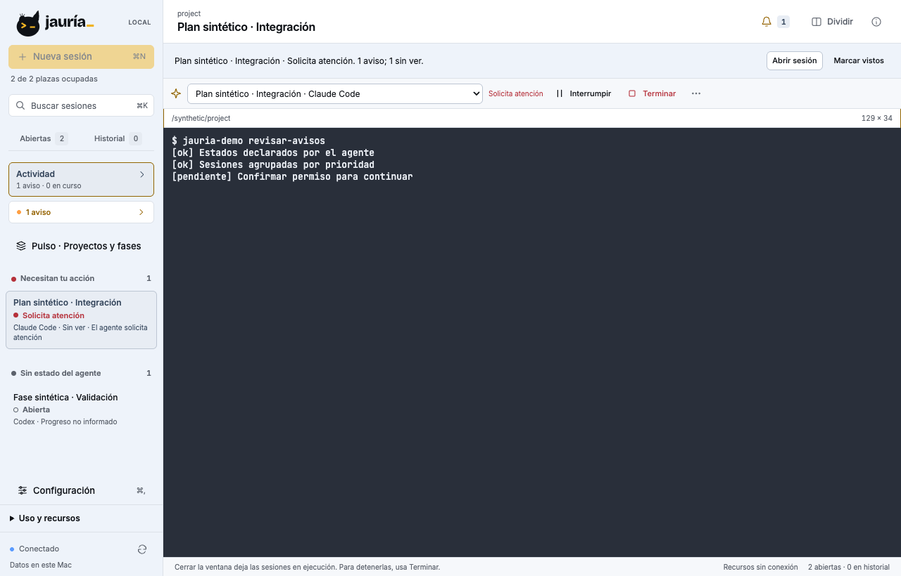
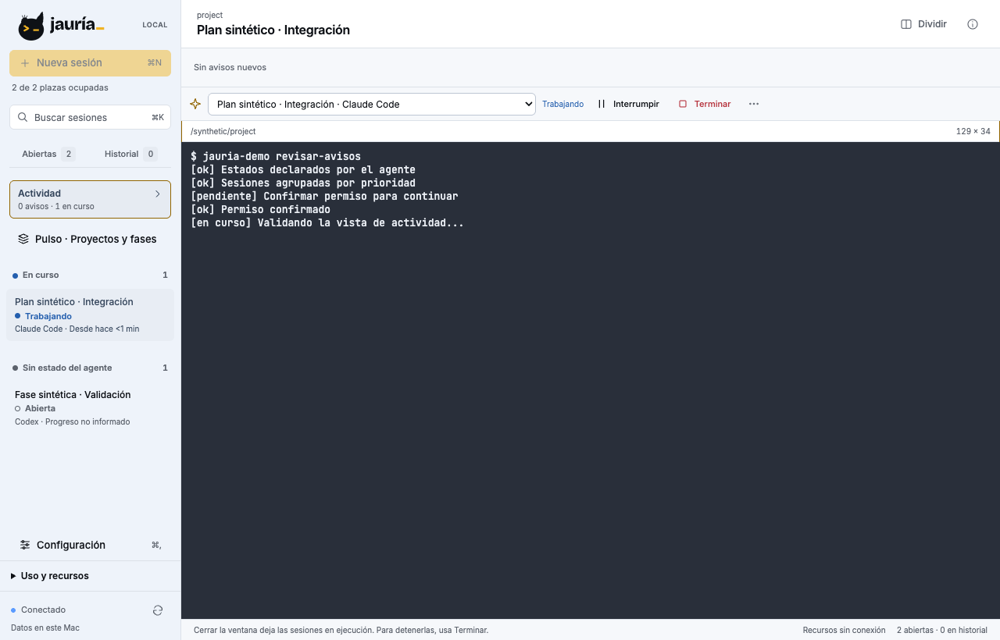
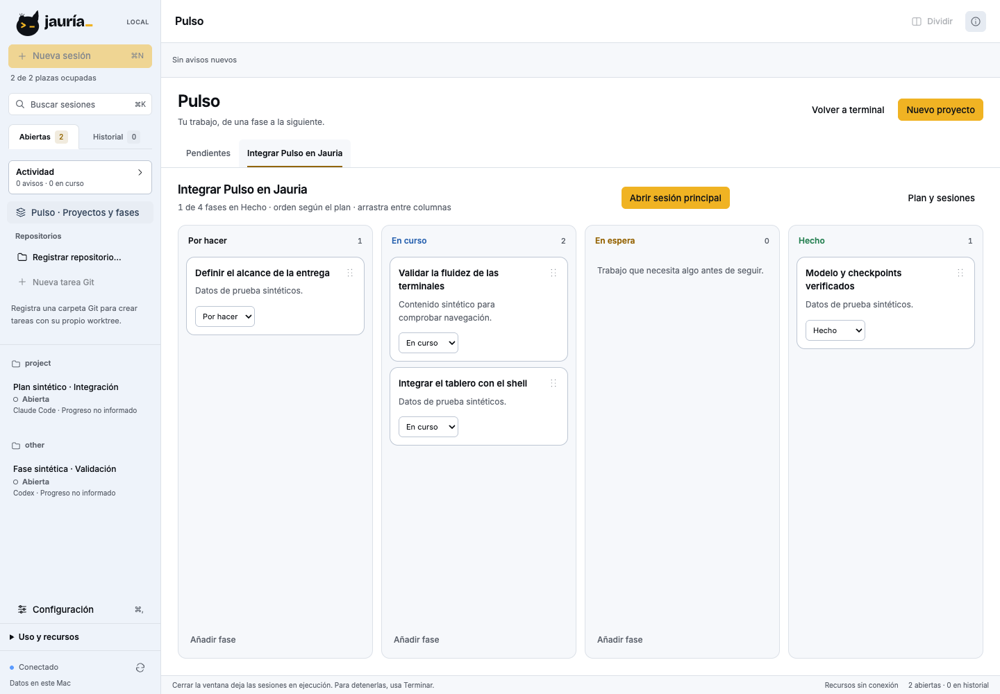
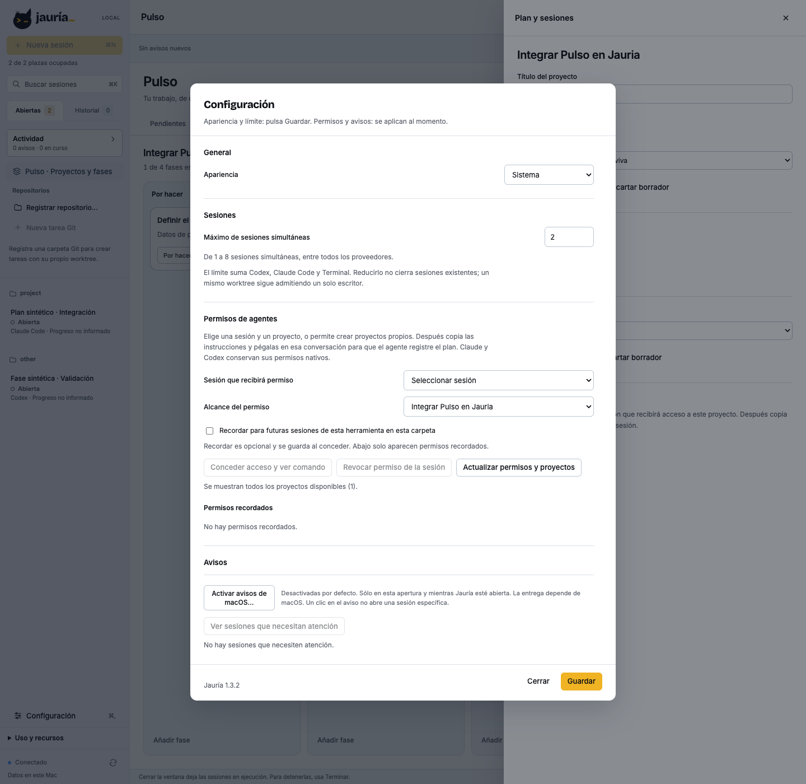

# Jauria 1.3.2 · Entrega estable

## Contenido

Esta versión conserva la vista **Actividad** y las reglas de avisos de [1.3.1](RELEASE_1.3.1.md). Renueva las capturas de Actividad, Pulso y Configuración con la interfaz actual y datos sintéticos. La terminal de demostración muestra el contexto del bloqueo y del trabajo en curso; no representa una conversación real ni un permiso concedido por Jauria.

La [release v1.3.2](https://github.com/StevenSantacruz56/jauria-sessions/releases/tag/v1.3.2) ofrece el código fuente correspondiente, `Jauria_1.3.2_aarch64_unsigned.dmg`, `SHA256SUMS` y su recibo JSON. El código de esta compilación queda fijado en la etiqueta `v1.3.2`; el DMG se verifica con `hdiutil verify` y se acompaña de una suma SHA-256. La app está destinada a macOS Apple Silicon. El nombre `unsigned` es deliberado: **no hay firma Developer ID ni notarización**. Una descarga puede ser bloqueada por macOS; no desactives Gatekeeper ni retires la cuarentena. Consulta [instalación](INSTALLATION.md).

## Capturas

[La misma vista en tema oscuro](screenshots/actividad-1.3.2-aviso-oscuro.png).

Las imágenes proceden del frontend real y un runner sintético en Chromium, sin perfiles, conversaciones ni rutas personales. El código de captura está en `tests/browser/pulso-workbench.test.ts`.

## Verificación y límites

La versión de frontend, runner, bridge y bundle es 1.3.2. `scripts/build-macos.py` aprobó 17 pruebas Python, 95 pruebas de frontend (cinco suites de navegador optativas omitidas en ese comando), 438 pruebas del runner y 40 del bridge nativo. La compilación release y el bundle Tauri aprobaron. Dos casos de navegador Chromium para las capturas de Actividad y Configuración aprobaron por separado.

El DMG pasó `hdiutil verify` y `shasum -a 256 -c SHA256SUMS`. Se montó en modo solo lectura y se comprobó su contenido, la versión 1.3.2 y los dos ejecutables arm64. El bundle montado contiene **cero rutas personales absolutas** con el patrón `/Users/<cuenta>/`. Su SHA-256 es `95445f3994043f6aa3aae4aea983f0b9bf55e2c4be10675dcd29efdd3bd0e519`. Los enlaces locales de documentación resuelven y las cinco capturas nuevas carecen de chunks de metadatos PNG de texto o EXIF.

La primera compilación de 1.3.2 contenía rutas absolutas del equipo en los lugares de pánico de Rust. Ese DMG se descartó sin publicarlo. El build ahora remapea el prefijo de fuente, Cargo y la carpeta personal, y el empaquetador rechaza un bundle que conserve rutas `/Users/<cuenta>/`. Esta comprobación evita esa exposición concreta; no certifica la ausencia de todos los datos sensibles.

GitHub Actions depende de la cuenta de GitHub: el job de 1.3.1 no se inició por un bloqueo de facturación. Una prueba local correcta no se presenta como CI aprobado. La entrega no valida proveedores reales, notificaciones entregadas por macOS, Gatekeeper en un segundo equipo ni plataformas distintas de macOS Apple Silicon. La [alerta GLib del lockfile](DEPENDENCIES.md) corresponde al grafo Linux/BSD y sigue pendiente para esos destinos.
