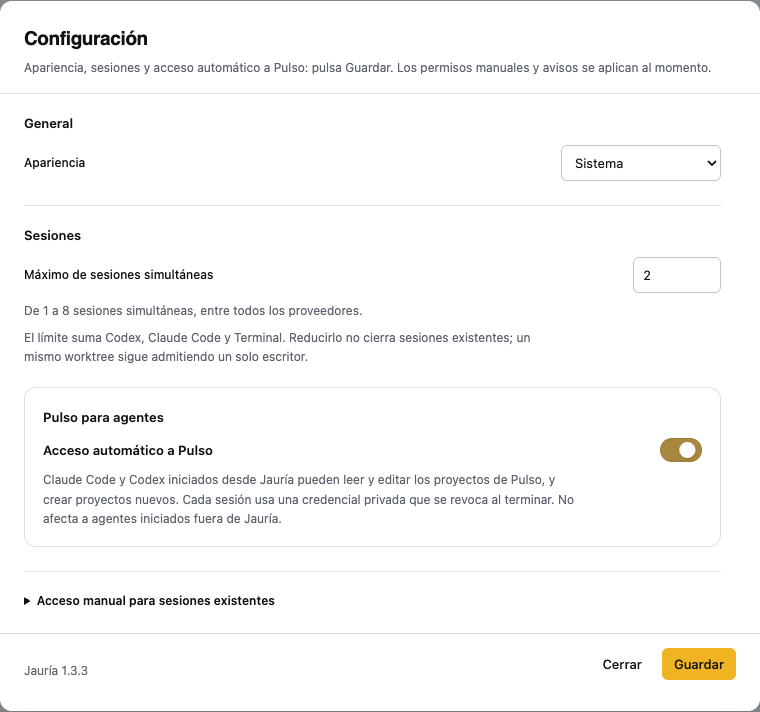

# Jauría 1.3.3 · Pulso disponible para agentes

La versión 1.3.3 conecta Pulso automáticamente con las sesiones nuevas de Claude Code y Codex iniciadas desde Jauría. En **Configuración → Pulso para agentes**, el acceso automático aparece activado y puede apagarse con un interruptor. El acceso manual para sesiones anteriores queda en una sección desplegable. [La guía de Pulso](PULSO.md#acceso-de-claude-code-y-codex-a-pulso) explica el alcance.

La captura usa datos sintéticos y no incluye sesiones, credenciales ni perfiles del usuario.

## Alcance y protección

- El acceso predeterminado permite leer y editar todos los proyectos locales de Pulso y crear proyectos. No incluye los pendientes independientes sin proyecto.
- Cada sesión usa una credencial privada distinta. El servidor MCP solo recibe la ruta del permiso y vuelve a validarlo en cada operación. La ruta no contiene el token.
- Los agentes iniciados fuera de Jauría no reciben esta conexión. Terminar la sesión revoca el permiso; apagar el interruptor bloquea las operaciones automáticas activas. Las aprobaciones nativas de archivos, comandos y red siguen en manos de Claude Code o Codex.
- Las políticas manuales recordadas por proveedor y carpeta conservan su alcance más estrecho. El modo de conversación estructurada de Codex mantiene deshabilitados los MCP ajenos a Jauría.

Una sesión ya abierta no carga retrospectivamente el servidor MCP. Puedes continuar en ella con el permiso manual y **Copiar instrucciones para el agente**, o iniciar una sesión nueva después de instalar esta versión.

## Verificación de la entrega

La versión de frontend, runner, bridge y bundle es 1.3.3. El build local ejecutó las pruebas del frontend, runner y bridge y compiló la app Apple Silicon. Las 56 pruebas de navegador de Configuración y permisos pasaron en Chromium y WebKit. El MCP del ejecutable empaquetado enumeró sus ocho herramientas sin exponer un token. El DMG pasó `hdiutil verify` y `shasum -a 256 -c SHA256SUMS`; su SHA-256 es `a59bb4b28ef68c53ea6bd205133cd04375389758cc80fde39ec5a956c91c0f52`.

La revisión de seguridad se concentró en la identidad de sesión, el alcance de proyectos, las credenciales privadas y la configuración efectiva de MCP. La inspección de las rutas modificadas y de la captura nueva no encontró credenciales ni rutas personales publicadas. El empaquetador rechaza rutas de usuario macOS en el bundle. Esta revisión no equivale a una auditoría integral.

El DMG se distribuye **sin firma Developer ID ni notarización**. macOS puede impedir su apertura; no desactives Gatekeeper ni elimines la cuarentena. Consulta [instalación](INSTALLATION.md).
