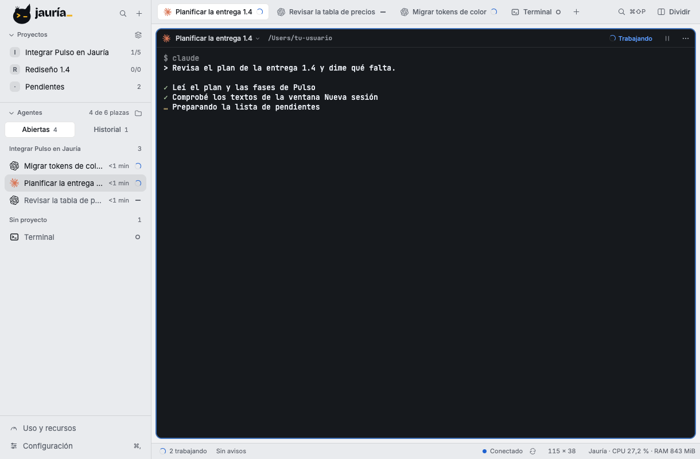
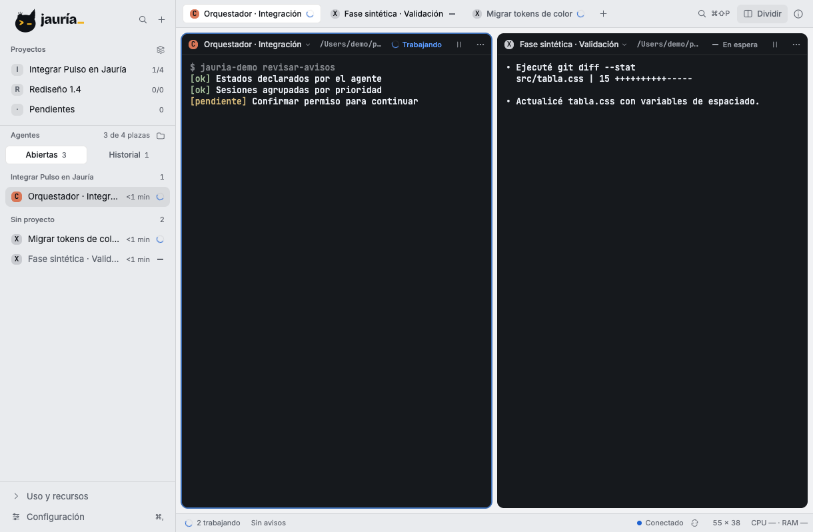
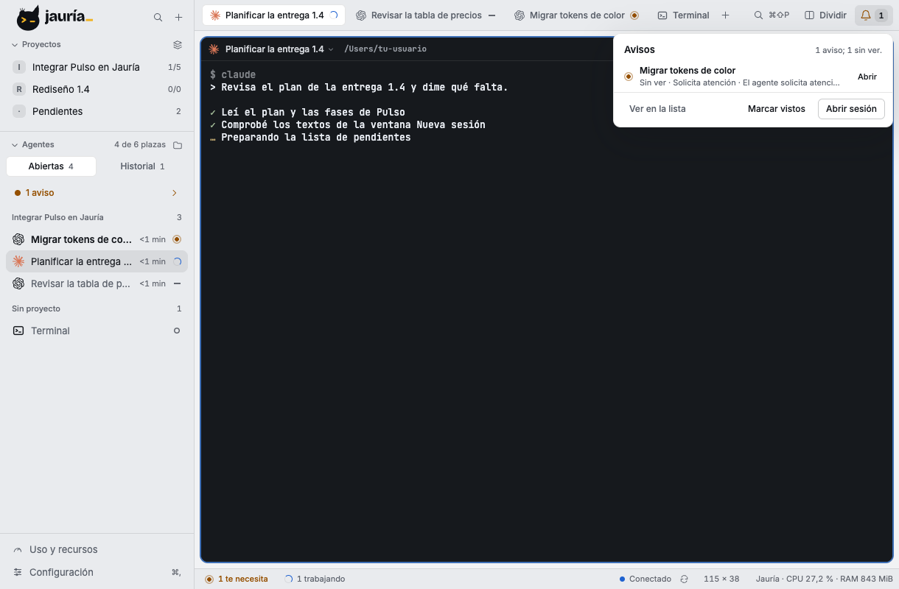
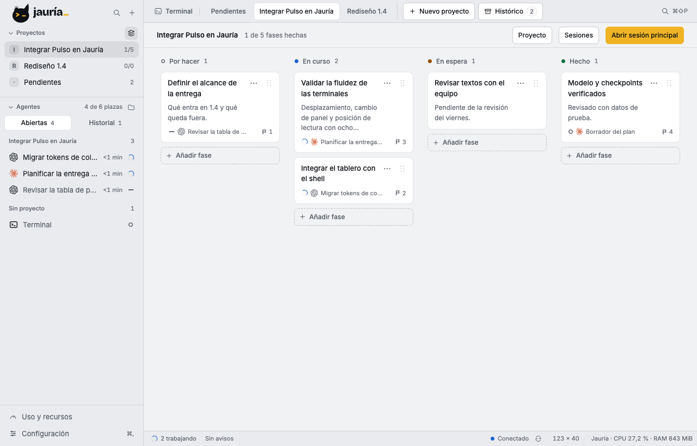
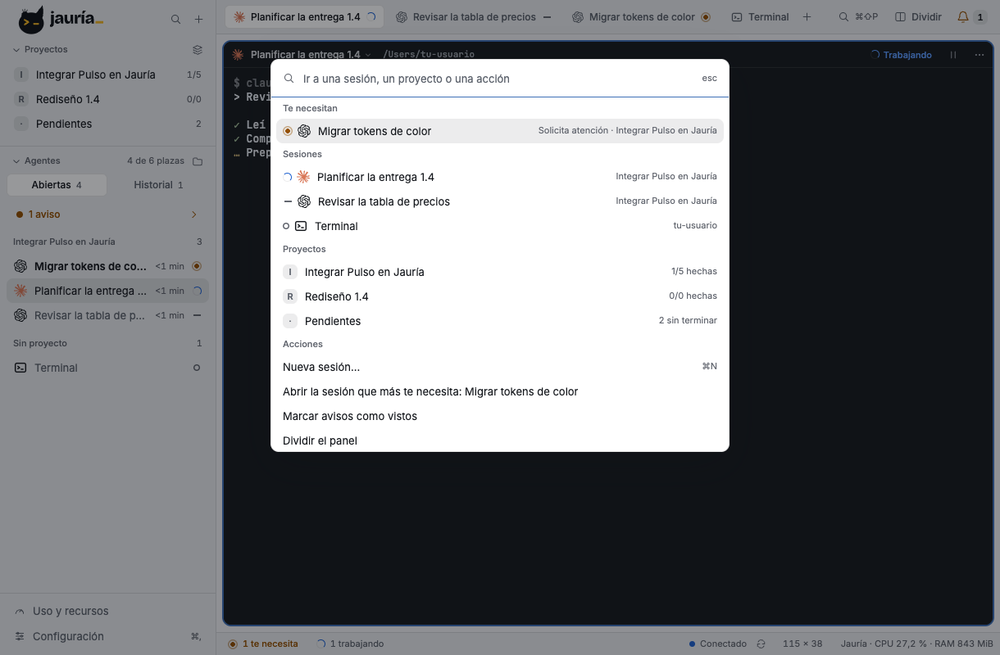
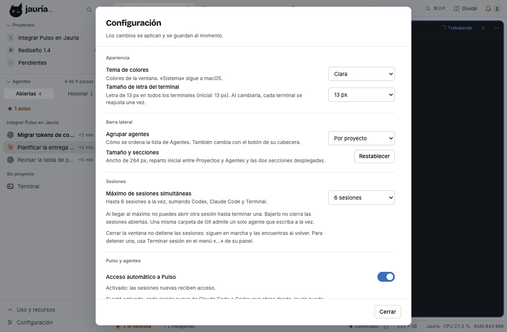

# Jauría 1.4.0 · Interfaz nueva y estado de los agentes en el runner

La versión 1.4.0 rediseña la ventana alrededor de los proyectos y los agentes, añade una paleta de comandos, conecta el tablero de Pulso con las sesiones y hace que el runner guarde el estado declarado de cada agente y lo que ya viste. Retira Repositorios y tareas Git. El detalle completo está en el [CHANGELOG](../CHANGELOG.md).

## Qué cambia

- **Barra lateral con Proyectos y Agentes.** Los tableros de Pulso con su avance y, debajo, una fila por sesión con proveedor, duración e indicador de estado. Cada estado tiene su forma: anillo giratorio (trabajando), punto con halo (te necesita), marca (terminó), guion (en espera) y aro vacío (sin reporte). Los agentes se agrupan por proyecto o por estado.
- **Barra superior con pestañas** (una por sesión abierta, más nueva sesión, búsqueda, Dividir, campana e Información), **paneles como tarjetas** con una **cabecera única** de 32 px y un **selector de sesión** con búsqueda. Una **barra de estado** resume quién te necesita, quién terminó y quién trabaja. Ya **no hay barra de avisos fija**: el aviso prioritario está en la cabecera del panel, en la campana y en la barra de estado, sin mover el terminal.
- **Paleta de comandos** con `⌘⇧P`: sesiones que te necesitan, sesiones abiertas, proyectos y fases de Pulso, y acciones. Nunca escribe en un terminal ni concede permisos.
- **Pulso:** pestañas de tableros en la barra superior, menú «…» → Mover en cada tarjeta, pie de tarjeta con la sesión vinculada y sus checkpoints, fases en la paleta, y una barra lateral y un tablero que se actualizan en un segundo o menos cuando un agente edita Pulso por MCP, sin sondeo.
- **Estado de los agentes en el runner:** el estado declarado, la duración del turno y lo visto sobreviven a cerrar la ventana y reconectar. Un turno terminado sin ver se conserva aunque el agente vuelva a trabajar; «te necesita» dura mientras el agente lo declara. Solo cuenta como visto abrir la sesión, pulsar Marcar vistos o mirar el terminal cuando el aviso se pinta. Al abrir la ventana lo pendiente aparece en la campana, la barra de estado y el Dock, pero macOS no notifica lo atrasado.
- **Retirado:** Repositorios y tareas Git (registro, worktree por tarea, revisión, verificación y relevo). Los datos antiguos del perfil se conservan y se ignoran; no se borra ningún worktree ni rama.
- **Corregido:** en la app 1.3.3 publicada, **Configuración → Guardar** fallaba siempre con su propio runner («Argumento no permitido») porque el puente nativo rechazaba `pulsoAutoAccess`. 1.4.0 lo corrige.

## Capturas

[La misma vista en tema oscuro](screenshots/terminal-1.4.0-oscuro.png).

[La misma vista en tema oscuro](screenshots/actividad-1.4.0-aviso-oscuro.png).

[El tablero en tema oscuro](screenshots/pulso-1.4.0-oscuro.png).

[La paleta en tema oscuro](screenshots/paleta-1.4.0-oscuro.png).

Las imágenes proceden del frontend real (CSS, xterm y la ventana completa) en Chrome con una frontera Tauri sintética: sin runner, perfiles, proveedores ni conversaciones reales. Las rutas `/Users/demo/…` y `/synthetic/…` son inventadas. Se generaron con `desktop/tests/capture-redesign.ts` (terminal, dos paneles, avisos y Configuración) y con las capturas opcionales de `tests/browser/pulso-revision.test.ts` y `tests/browser/command-palette.test.ts` (Pulso y paleta). No contienen chunks PNG de texto ni EXIF.

## Compatibilidad y actualización desde 1.3.x

Sigue [la guía de instalación](INSTALLATION.md#actualizar-una-instalación-existente): termina de forma controlada las sesiones administradas por Jauría, reemplaza la app y, si Información → Diagnóstico indica un runner anterior, usa **Reiniciar runner…** solo cuando no quede trabajo activo. Cerrar la ventana no termina el runner ni sus sesiones.

- **Perfil:** el esquema sigue en `user_version` 5. `runner.sqlite` añade la tabla `agent_attention`; `pulso.sqlite` no cambia. Las tablas de Repositorios se conservan con la misma definición.
- **App 1.4 con el runner 1.3.x que sigue vivo:** funciona en modo degradado, como 1.3.3. Sesiones, Pulso, MCP, permisos e historial funcionan; el estado y lo visto viven solo en la ventana y se reinician al reconectar, el tablero consulta su revisión cada 2 s y las tarjetas no tienen pie. Lo nuevo del runner llega al reiniciarlo.
- **App 1.3.x con runner 1.4:** conecta, no ofrece Repositorios y Diagnóstico muestra «runner anterior» por las capacidades retiradas (un aviso de más). Esta combinación está **deducida del código**; no se probó con la app 1.3.x.
- **Vuelta atrás a 1.3.3:** el runner de v1.3.3 abre un perfil usado por 1.4, purga y compacta sin tocar `agent_attention`; se comprobó con su binario el 23 de noviembre de 2026 ([procedimiento](DEVELOPMENT.md#vuelta-atrás-a-la-versión-anterior-paso-de-la-lista-de-release)). Con datos antiguos de Repositorios, el runner 1.3.x modifica al abrir las tareas y verificaciones a medio hacer; ese caso no se probó.
- Las sesiones iniciadas antes de actualizar no cambian de ejecutable ni de permisos. Para el MCP de Pulso en una sesión existente, consulta [la guía de Pulso](PULSO.md#acceso-de-claude-code-y-codex-a-pulso).

## Verificación de la entrega

Baterías del proyecto y últimos resultados conocidos **en la rama `feat/redesign-1.4`, antes del build de la entrega**. `scripts/build-macos.py` vuelve a ejecutarlas sobre el commit final; solo esos resultados validan el paquete.

| Batería | Último resultado conocido en la rama |
| --- | --- |
| Escritorio, unidad (`node --test tests/*.test.ts`) | 168 pasadas, 0 fallidas, 5 salteadas (166 antes de `9587643`, que añadió dos pruebas) |
| Navegador (`tests/browser/*.test.ts`, Chrome y WebKit) | 131 pasadas, 0 fallidas |
| `pulso-panel` (Chrome y WebKit) | 131 pasadas |
| Configuración y permisos (`settings-panel`, `agent-permissions`) | 56 pasadas |
| `attention-consistency` (Chrome + WebKit) | 9 + 9 pasadas |
| `terminal-stream` (Chrome + WebKit) | 15 + 15 pasadas |
| Runner (`cargo test --locked` y suites RPC) | 356 pasadas, 0 fallidas, 6 salteadas |
| Puente nativo (`desktop/src-tauri`, `cargo test --locked`) | 43 pasadas |
| Python (`tests/`) | 24 pasadas |

Las 6 pruebas salteadas del runner son mediciones (`listener_latency`, `pulso_latency`, ráfaga del PTY y escalas de Pulso) y la comprobación de vuelta atrás, que necesita el binario de la versión anterior; se activan a mano con `--ignored`.

**Build de la entrega (23 de noviembre de 2026, commit `ad87506`).** `python3 scripts/build-macos.py` terminó sin fallos en un Mac Apple Silicon y produjo el bundle `Jauria.app` 1.4.0 sin firma. Ejecutó, sobre ese commit: Python 24 pasadas; escritorio, unidad 168 pasadas, 0 fallidas, 5 salteadas; navegador 131 pasadas, 0 fallidas; `pulso-panel` 131 pasadas; Configuración y permisos 56 pasadas; `attention-consistency` 9 + 9 pasadas; `terminal-stream` 15 + 15 pasadas; runner 356 pasadas, 0 fallidas, 6 salteadas; puente nativo 43 pasadas. No se generó DMG ni checksum: esta entrega no está empaquetada para distribución.

La versión de frontend, runner, puente y bundle es 1.4.0 (`python3 scripts/version.py --check`).

**Validación en la app empaquetada: pendiente.** Antes de publicar hay que comprobar en el `.app` de este build lo que las pruebas sintéticas no cubren: Guardar Configuración contra el runner real, la entrega de avisos de macOS y el visto automático con el cajón lateral. El resultado se registrará en esta sección.

**Revisión.** Cada entrega (A a E) tuvo una revisión independiente con Codex, sus hallazgos se corrigieron y una revisión final del conjunto llevó a las correcciones de la última sección del CHANGELOG. Fueron revisiones de código y de comportamiento; **no fue una auditoría integral de seguridad**.

## Límites conocidos

- **Frontera Tauri sintética.** Las pruebas de interfaz simulan el puente nativo. Por eso no detectaron el fallo de Guardar Configuración de 1.3.3, que estaba en el puente; ahora una tabla compartida comprueba cada operación contra el puente y el runner, pero la validación en la app empaquetada sigue pendiente (ver arriba).
- **CI:** el workflow de macOS ya incluye las suites de navegador, pero **aún no se ha ejecutado** con ellas. Una prueba local correcta no se presenta como CI aprobado.
- **El estado de un agente es lo que declara la salida del terminal** (OSC 7501), no una verificación: cualquier programa de la sesión puede emitirlo. El modo estructurado de Codex no declara estado y aparece como progreso no informado.
- **Durabilidad de los avisos:** lo visto se confirma en disco; el resto se guarda en lotes de menos de 250 ms, así que una caída del runner puede perder hasta ese tramo. Al cerrar, el vaciado es de mejor esfuerzo durante como mucho 3 s.
- **El aviso de proceso terminado no se marca visto solo**, aunque estuvieras mirando la sesión: hay que volver a abrirla o pulsar Marcar vistos. Lo mismo ocurre con las solicitudes de permiso.
- **macOS no notifica lo atrasado** al abrir la ventana; lo pendiente solo aparece en la campana, la barra de estado y el Dock.
- **App 1.3.x con runner 1.4:** comportamiento deducido del código, sin prueba con esa app.
- **DMG sin firma Developer ID ni notarización.** macOS puede impedir su apertura; no desactives Gatekeeper ni elimines la cuarentena. Consulta [instalación](INSTALLATION.md).
- **Dependabot:** sigue la alerta por GLib 0.18.5 ([GHSA-wrw7-89jp-8q8g](https://github.com/advisories/GHSA-wrw7-89jp-8q8g)), igual que en 1.3.3. Pertenece al grafo GTK de Linux/BSD; `cargo tree --offline --locked --target aarch64-apple-darwin -i glib` no encuentra dependientes en macOS. Detalle en [DEPENDENCIES.md](DEPENDENCIES.md).
- Solo macOS Apple Silicon. No se validan proveedores reales ni Gatekeeper en un segundo equipo.
